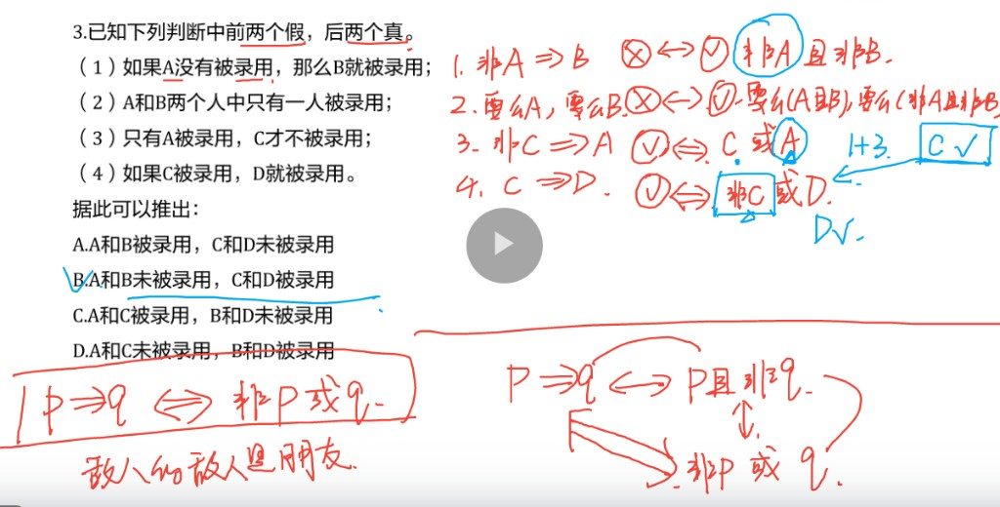

# 判断推理 · 速记笔记

> **上篇**形式逻辑｜**下篇**可能性推理（削弱 / 加强 · 解释等）｜**类比**词语关系｜**定义**要件比对

---

# 上篇 · 形式逻辑

**做题**：翻译 → 定类型 → 套规则 → 只选「一定能推出」  
排除：否前、肯后、有些互推、两「有些」硬推。

## 一、四类命题

| 类型 | 形式 | 矛盾 | 核心用法 |
|------|------|------|----------|
| 直言 | 所有/某个/有些 A 是(非) B | 量词对调 + 肯否对调 | 所有 → 某个 → 有些（只可向下） |
| 联言 | p 且 q | 非p 或 非q | 「且」为**假**：一边真 → 另一边假 |
| 选言 | p 或 q | 非p 且 非q | 「或」为**真**：一边假 → 另一边真 |
| 假言 | p → q | p 且 非q | 肯前肯后、否后否前 |

**直言**：找矛盾＝所有↔有些，且是↔非（两步一起改）。  
`所有 → 某个 → 有些` 可向下；**有些是 ≠ 有些非**。

**联言 / 选言**

| | 联言（且） | 选言（或） |
|--|-----------|-----------|
| 推理 | 「且」假：一边真→另一边假 | 「或」真：一边假→另一边真 |
| 例 | 又高又帅假；高真→帅假 | 考公或考研真；没考公→必考研 |

选言分两种（**不是同一概念**）：

| | **相容选言**：p **或** q | **不相容选言**：**要么** p，**要么** q |
|--|--------------------------|----------------------------------------|
| 含义 | 至少一个真；**可同时真** | **恰好一个**真；不可兼得 |
| 两边都真 | **真** | **假** |
| 一边假 | 另一边必真 | 另一边必真 |
| 一边真 | 另一边可真可假 | 另一边必假 |
| 例 | 考公或考研（两个都考也成立） | 要么考公，要么考研（只能一条路） |

**假言 ★**

```
p → q  ＝  非q → 非p     （逆否等价）
p → q  ＝  非p 或 q
假言为假：p 且 非q
```

| | 规则 | 例：下雨 → 地湿 |
|--|------|------------------|
| ✅ | 肯前 → 肯后 | 下雨了 → 地一定湿 |
| ✅ | 否后 → 否前 | 地不湿 → 一定没下雨 |
| ❌ | 否前 | 没下雨 → 地不一定干 |
| ❌ | 肯后 | 地湿了 → 不一定下过雨 |

---

## 二、关联词速查

> 三段论与前提型合在一起，见下篇「八 · 1. 前提型」。

| 说法 | 逻辑 |
|------|------|
| 如果 / 只要 p 就 q | p → q |
| 只有 q 才 p；除非 q 否则非 p | p → q（q 是必要条件） |
| p 是 q 的充分 / 必要条件 | p→q / q→p |
| 既 p 又 q | p 且 q |
| p 或者 q | 相容或 |
| 要么 p，要么 q | 不相容或（恰一个） |

---

## 三、真假话综合例 ★

**题眼**：已知若干句真/假 → **假的取矛盾，真的按规则推**（假言假＝前真后假）。

**例**（前两假、后两真；问谁被录用）

| # | 原句 | 翻译 | 真假 | 推出 |
|--|------|------|------|------|
| ① | 如果 A 没录用，那么 B 就录用 | 非A → B | 假 | **非A 且 非B** |
| ② | A、B 中只有一人录用 | 恰一（要么） | 假 | 同真或同假（与①一致：都未录用） |
| ③ | 只有 A 录用，C 才不录用 | 非C → A | 真 | 逆否：非A → C → **C 录用** |
| ④ | 如果 C 录用，D 就录用 | C → D | 真 | 肯前 → **D 录用** |

结论：A、B 未录用，C、D 录用。



---

# 下篇 · 可能性推理（削弱 / 加强）

## 四、常见论证模型 ★

包含：**求异论证**、**溯因论证**、**实践论证**、**双观点**、**类比推理**、**枚举归纳**、**数据论证**。  

### 1. 求异论证

**是什么**：通过**对比**实验、调查，得出**因果关系**。

思路：两组其他条件差不多，只有一个因素不同，结果也不同 → 该因素就是原因。

| | 小李 | 小王 |
|--|------|------|
| 相同 | 湖南人、成绩好 | 湖南人、成绩好 |
| 结果不同 | **身体好** | **身体不好** |
| 因素不同 | **爱运动** | **不爱运动** |

结论：爱运动 → 身体好。

| 方向 | 怎么打 |
|------|--------|
| **削弱** | ① 两组对象有其他**不同属性**；② **因果倒置** |
| **加强** | ① 两组对象有其他**相同属性**；② **解释因果** |

### 2. 溯因论证

**是什么**：发现一个**现象 A**，推测其产生的**原因 B**（结构：**因为 B，所以 A**）。

| | 内容 |
|--|------|
| 现象 A | 小李身体好 |
| 推测原因 B | 爱运动 |

结论：爱运动 → 身体好（由果推因）。

| 方向 | 怎么打 |
|------|--------|
| **削弱** | ① **否定此因**（不是因为爱运动）；② **另有他因**（身体好另有别的原因） |
| **加强** | ① **解释因果**；② **排除他因** |

### 3. 实践论证

**是什么**：**采取方案 A，达到目的 B**。

例：为了让**身体更健康**（目的 B），小李决定**多运动锻炼**（方案 A）。

| 方向 | 怎么打 |
|------|--------|
| **削弱** | ① **方案 A 不可实现**；② **达不到目的 B** |
| **加强** | ① **方案 A 可实现**；② **能达到目的 B** |

### 4. 双观点

**是什么**：针对同一现象的原因，有两个不同观点。

| | 说法 |
|--|------|
| 原观点 | **A** 是 B 的原因（压力大 → 小李脱发） |
| 反对者 | **C** 是 B 的原因（熬夜 → 小李脱发） |

**常见削弱反对者**：**A 是 C 的原因**（压力大 → 熬夜）→ A 才是**根本原因**，反对者被削。

### 5. 类比推理

**是什么**：两组对象有**相似属性**，据此认为还有**其他相似属性**。

| | 甲 | 乙 |
|--|----|----|
| 已知相似 | 女性、170、25 岁 | 女性、170、25 岁 |
| 推出 | 穿这件衣服**好看** | 也**好看**？ |

| 方向 | 怎么打 |
|------|--------|
| **削弱** | 找**根本不同属性** |
| **加强** | 找**根本相同属性** |

### 6. 枚举归纳

**是什么**：**样本**具有某种属性，认为**所有对象**都具有该属性。

例：从不透明盒子拿出 10 个球都是红色的 → 认为盒子里所有球都是红色的。

| 方向 | 怎么打 |
|------|--------|
| **削弱** | 样本不具有**代表性** |
| **加强** | 样本有**代表性** |

### 7. 数据论证

**是什么**：题干通过**数据对比**得出结论。

例：人行道上受伤人数是滑冰场的 **2 倍**（**绝对数**）→ 认为滑冰场**更安全**（**相对比**）。

陷阱：用绝对数推相对结论，忽略**环境比例（基数）**（两边总人数可能差很多）。

| 方向 | 怎么打 |
|------|--------|
| **削弱 / 加强** | **补充环境比例（基数）**，使结论不成立 / 成立 |

### 论证模型速查总表 ★

| 模型 | 削弱 | 加强 |
|------|------|------|
| **求异** | 其他不同属性；因果倒置 | 其他相同属性；解释因果 |
| **溯因** | 否定此因；另有他因 | 解释因果；排除他因 |
| **实践** | 方案不可实现；达不到目的 | 方案可实现；能达到目的 |
| **类比** | 根本不同属性 | 根本相同属性 |
| **枚举** | 样本无代表性 | 样本有代表性 |
| **数据** | 补基数→结论不成立 | 补基数→结论成立 |
| **双观点** | 削反对：根本原因 | — |

---

## 五、做题顺序 ★必背

**① 梳理主线**（先盯结论）

```
论据 → 论证 → 结论
```

定类型：是 **因果**（A 导致 B）？还是 **缺桥**（论据 AB、结论 AC）？

**② 选项定性**（对号入座）

| 削弱 | 加强 |
|------|------|
| 因果倒置 | 解释因果 |
| 另有他因 / 根本原因 | 排除他因 |
| 有因无果 | 有因有果 |
| 无因有果 | 无因无果 |
| 切断联系 | 建立联系 |

主观观点、空表态 → **直接排除**（没有用）。

**③ 选项比较**（多个都像对时）

1. 话题一致吗？（防**偷换概念**）  
2. **本质 > 举例**  
3. **直接 > 间接**

---

## 六、削弱 / 加强总表

### 因果关系类（结论：A 导致 B）

| 削弱（力度） | 加强（力度） |
|--------------|--------------|
| **因果倒置**（最大）· B→A | **解释因果**（最大）· 为何 A→B |
| **另有他因**（可能）· C→B | **排除他因**（间接） |
| **根本原因**（必然）· C 是根本因 | — |
| **有因无果**（举例） | **有因有果**（举例） |
| **无因有果**（举例） | **无因无果**（举例） |

### 缺桥类（论据 AB；结论 AC）

| 削弱 | 加强 |
|------|------|
| **切断联系**（切断 BC）· 容易出错 | **建立联系**（补上 BC） |

---

## 七、无效选项

| 类型 | 例 | 为何没用 |
|------|-----|----------|
| 主观观点 | 我认为 / 大家都觉得 / 某人支持 | 只表态，不动论证 |
| 空权威 | 专家说对（不给理由） | 没解释、没拆桥/建桥 |
| 情感评价 | 不好 / 很有意义 | 态度 ≠ 逻辑 |
| 无关项 | 沾边但不打 A→B 或 BC | 推不动结论 |

---

## 八、前提 / 解释 / 结论 / 评价型 ★

### 1. 前提型 · 三段论 ★

**题干问法**（盯「前提 / 假设」）

- 上述论证还需基于以下哪一**前提 / 假设**？
- 要使上述推断成立，必备的前提 / 假设条件**不包括**：

核心：**前提 = 必要条件**（结论成立的前提 = 结论成立的必要条件）。

补前提常用两种思路：**搭桥法**、**三段论**。

#### （1）搭桥法

| | 符号 | 例 |
|--|------|-----|
| 论据 | A B | 小李学逻辑 |
| 结论 | A C | 小李有对象 |
| **补前提** | **B C** | 学逻辑的人有对象 |

搭桥：建立论据与结论间**跳跃概念**的联系（B 与 C）。

#### （2）三段论

中间概念当**桥**：桥稳才能必然推出；缺前提时补全中间桥。

```
所有土木生 → 工科生；小明 → 土木生  ⇒  小明 → 工科生 ✅
```

**优先画圈**：怎么画都对 → 能推；有的对有的不对 → 推不出。

| 硬规则 | 含义 |
|--------|------|
| 两个「有些」 | 一律推不出 |
| 「有些」↛「所有」 | 个别推不出全体 |
| 两个「不是」↛「是」 | 两否不得肯定 |
| 所有 A 是 B + 某人是 A | → 某人是 B（最常见能推） |

做题：翻译 → 画圈 → 见两「有些」直接排除。  
（周延＝说全了这一类；中项至少周延一次＝桥被说全过。）

### 2. 解释型

**题干问法**（盯「能解释」）

- 以下哪项如果为真，**（不）能解释**上述现象？
- 以下哪项如果为真，**最（不）能解释**上述现象？

**做题要点**

1. 解释题干中**看似不合理的现象**  
2. 全面、准确概括**转折词前后**，确定解释对象  
3. 正确选项应是题干现象产生的**原因**

### 3. 评价型

**题干问法**（结构 / 谬误是否相似）

- 下列选项中所犯**逻辑错误**与上述推理最为相似的是：
- 下面句子**逻辑表述方法**与所给题干一致的是：
- 以下哪项的**逻辑结构**与题干的最为类似？
- 以下哪项与题干中的**论证方式**相同？
- 下列最能说明上述推理**不成立**的是：

**解题思路**

| 题干类型 | 怎么抽 |
|----------|--------|
| **必然性推理** | 提炼**逻辑形式** |
| **可能性推理** | 概括**论证模型** |

**解题策略**

1. **提炼**题干的推理形式，或概括论证过程、逻辑谬误  
2. 对比选项，找出**相似性最强**或**最弱**的选项

### 4. 结论型

**题干问法**（能不能推出）

- 根据以上表述，下列判断**一定正确**的是：
- 由此可以推出：
- 下面哪一个结论最能被上面的论述**支持**？

核心：判断选项是否能根据**题干信息**得出。

**解题思路**：**定位原文 → 判断正误**。

---

## 九、类比推理（词语关系）★

> 不同于论证模型「类比」：这里是**词与词的关系**。  
> 总纲：**横向观察找关系；常态思维进去比。** 顺序：三大类 → **先含义后结构** → 常识细比。

### 一页速查（关系 + 二次辨析）

| 大类 | 关系 | 二次辨析 | 例 |
|------|------|----------|-----|
| **逻辑·概念** | 全同 | 同一所指 | 老鼠：耗子 |
| | 全异 | **反对/矛盾**；命名维度；有无中间态 | 黑白 / 曲直 |
| | 交叉 | 维度不同可重叠 | 博士：女士 |
| | 包含 | 个体/集合；**自然/人工** | 苹果：水果 |
| **逻辑·时序** | 因果 | 结果**好坏** | — |
| | 顺承 | **主客体**一致；常考**三词型**时间链 | 质疑判罚∶提出申诉∶改变判罚 → 急诊入院∶安排手术∶康复出院 |
| | 条件 | **必要/充分** | — |
| **言语·含义** | 近义 | **色彩、轻重**；词性 | — |
| | 反义 | **色彩**；词性 | 非常/非难 |
| | 释义/指代 | 解释、象征 | 青松：坚韧 |
| **言语·结构** | 偏正 | 形+中心语 | — |
| | 动宾 | 动+客体 | 实力：展示 |
| | 主谓 | 主+动/形 | 阳光：明媚 |
| | 并列 | **内部结构**一致 | 下棋：书画 |
| **经验常识** | 组成 | 核心/非核心；**内/外** | 湖北：中国 |
| | 功能 | 主/次；时间；单/多 | 空调：暖气 |
| | 加工 | **物理/化学** | 布：衣 / 麦：酒 |
| | 命名 | **形材功意音** | — |
| | 特征 | 内/外 | 火→热 |
| | 职业 | 场所；工具；对象 | 医生：手术刀 |
| | 位置 | 所在 | 飞机：机场 |

成语看**目的是否实现**；同语素注意**比喻义**。

**顺承例（2026 上联考 A）**：质疑判罚∶提出申诉∶改变判罚  
→ 选：急诊入院∶安排手术∶康复出院（严格先后；主体一贯）。  
做题：先锁时间链 → 再对**主客体** → 排除顺序可颠倒、主体中途更换的项。

---

## 十、定义判断 ★

### 做题流程

```
看问法定义 → 圈要件 → 逐选项比对 → 排除
```

1. **先看问法**：问「属于」还是「不属于」；多定义先定位到问的那个定义；
2. **圈要件**：定义拆成一个个必要条件（要件），全部满足才属于；**一个不符就排除**；
3. **逐项比对**：先比容易的（主体、客体），再比难的（方式、结果）；
4. **拿不准回原文**：回定义里定位那个关键词再判。

### 要件清单（八要素）

| 要素 | 盯什么词 | 例 |
|------|----------|-----|
| **主体** | 谁来做（身份、机构） | 行政机关、企业、消费者 |
| **客体** | 作用于谁 / 什么 | 财物、他人、市场 |
| **目的** | 为了…（为了 / 旨在 / 以…为目的） | 为了牟利 |
| **方式** | 怎么做（通过 / 利用 / 采取 / 以…手段） | 以书面形式 |
| **条件** | 在什么前提下（当 / 在…过程中 / 紧急状态） | 不可抗力发生时 |
| **结果** | 造成什么（导致 / 使得 / 造成） | 造成经济损失 |
| **原因** | 为什么（由于 / 基于 / 鉴于） | 因经营需要 |
| **性质** | 定性表述 | 非法占有、无偿 |

不是每个定义都有八项——**抓定义里实际写到的要件**，别自己脑补。

### 目的 vs 结果（高频坑）★

| | 定义写法 | 选项要求 |
|--|----------|----------|
| **目的** | 旨在 / 为了 / 以…为目的 | **不要求真的实现**，有这个意图即可 |
| **结果** | 导致 / 造成 / 使得 | **必须实际发生** |

> 例：「旨在提高效率」——方案没提高效率也算符合；「导致伤亡」——没伤亡就不符合。

### 陷阱清单

| 陷阱 | 特征 | 例 |
|------|------|-----|
| **偷换主体** | 主体身份不符 | 定义「行政机关」，选项「事业单位」 |
| **方式偷换** | 手段对不上 | 定义「书面」，选项「口头」 |
| **范围扩大 / 缩小** | 量级对不上 | 定义「某些」，选项「所有」 |
| **无中生有** | 选项加了定义没有的要件 | 定义没提金额，选项强调金额 |
| **时间错位** | 阶段对不上 | 定义「事后」，选项「事前」 |

「不属于」题反过来用：**找一个要件不符，直接选**。

### 多定义

- **问哪个看哪个**：先定位目标定义，其他定义是干扰；
- 选项纠结、两个定义像时：把选项分别代进两个定义，看要件归哪边；
- 有的题一个选项横跨两个定义的要件——回目标定义原文找区别词。

### 生僻定义看不懂时

定义本身读不懂（法律、经济术语）：

1. **别死磕字面**，直接看选项，找**选项之间的差异点**；
2. 拿差异点回定义找对应关键词，只比这一处；
3. 差异点比对不过来时，选**和定义字面重合度最高**的（下策）。

### 例（要件比对示范）

**应急物流**：指为应对突发性自然灾害、公共卫生事件等**突发事件**（条件），对物资、人员等**进行紧急保障**（方式）的特殊物流活动。

| 选项 | 比对 | 判定 |
|------|------|------|
| A. 地震后向灾区紧急调运帐篷 | 突发事件 ✔ 紧急保障 ✔ | **属于** |
| B. 电商为促销大促加急发货 | 非突发事件 ✘ | 不属于 |
| C. 部队日常例行物资运输 | 无「紧急保障」✘ | 不属于 |
| D. 洪灾后政府拨付资金重建 | 是资金拨付，非物流活动 ✘ | 不属于 |

要件就两个（条件 + 方式），逐项对，不符即排。

**例（众筹 · 定义没写的要件就是排除依据）**：众筹 = 通过互联网发布筹款项目、实施方案、**投资回报**的资金募集方式。问哪个属于众筹：

| 选项 | 比对 | 判定 |
|------|------|------|
| A. 红十字会发布灾情呼吁捐款捐物 | 无**投资回报**，是慈善捐赠 ✘ | 不属于 |
| B. 毕业生网上发布创意求资金援助 | 无回报承诺，是个人求助 ✘ | 不属于 |
| C. 学校为患病学生发起募捐 | 无回报，是募捐 ✘ | 不属于 |
| D. 艺术家网络筹资，逐一兑现「展品收藏待遇」承诺 | 有**投资回报** ✔ | **属于** |

众筹 vs 捐赠 / 募捐 / 求助，分界就在**有没有回报**——定义要件「投资回报」一个词定生死。

---

*假言以「p→q = 非q→非p」为准；加强削弱打在「论据→结论」上；定义判断要件全中才属于，「不属于」找一处不符即可。*
