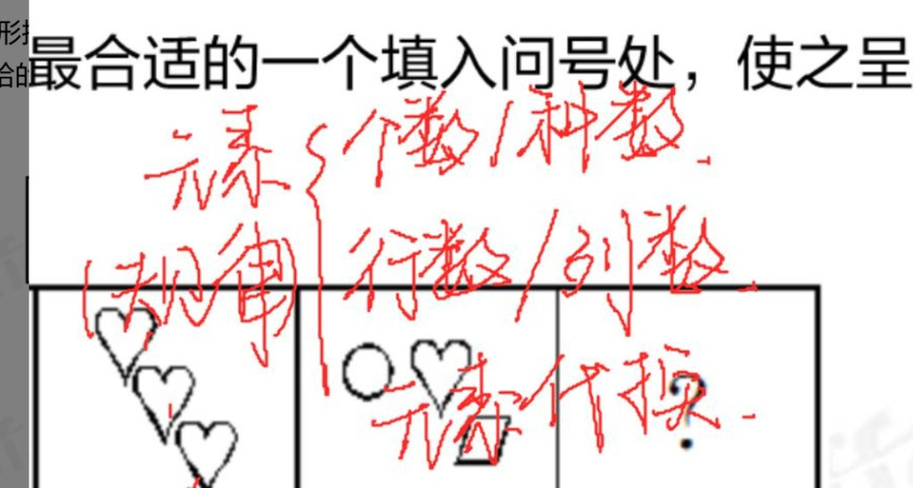
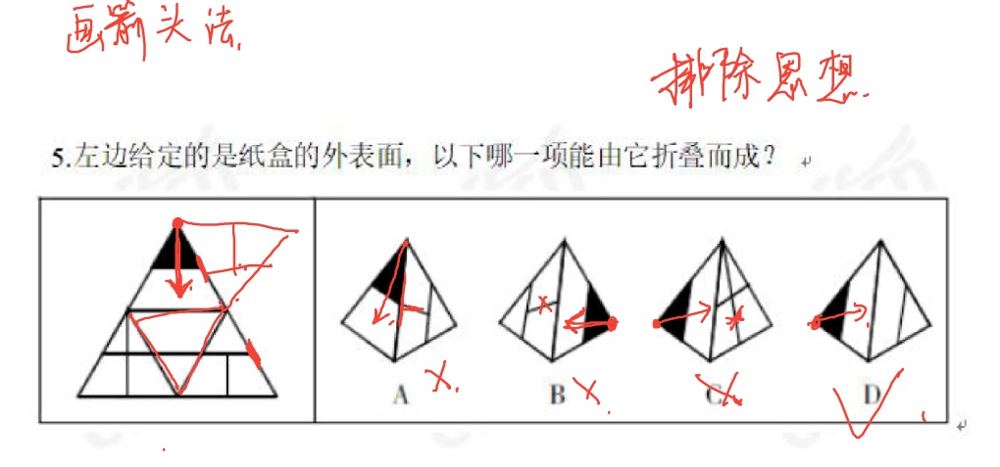
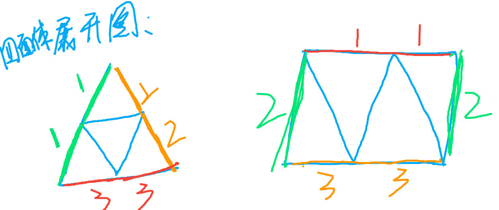
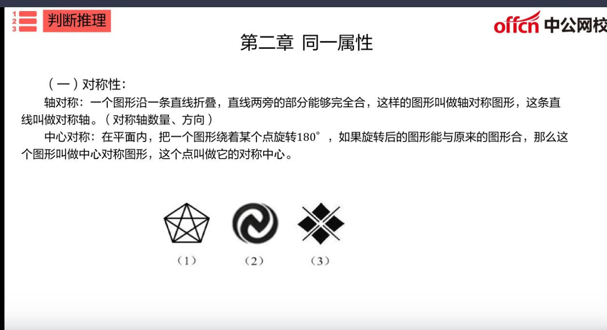
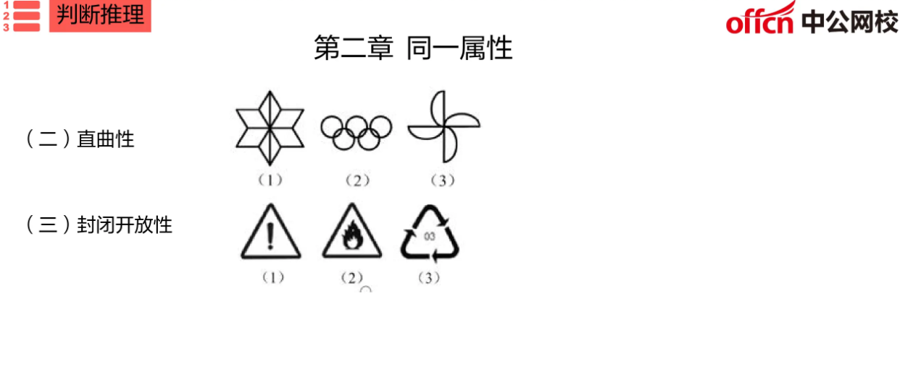
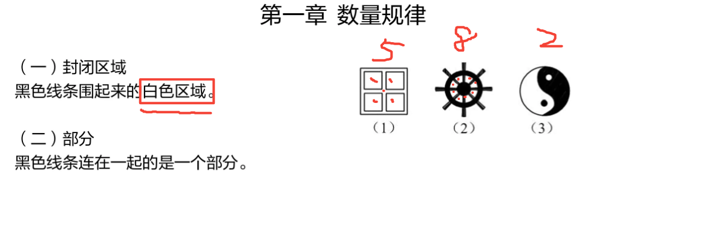
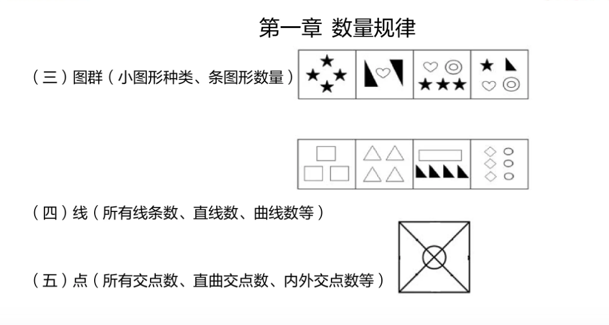
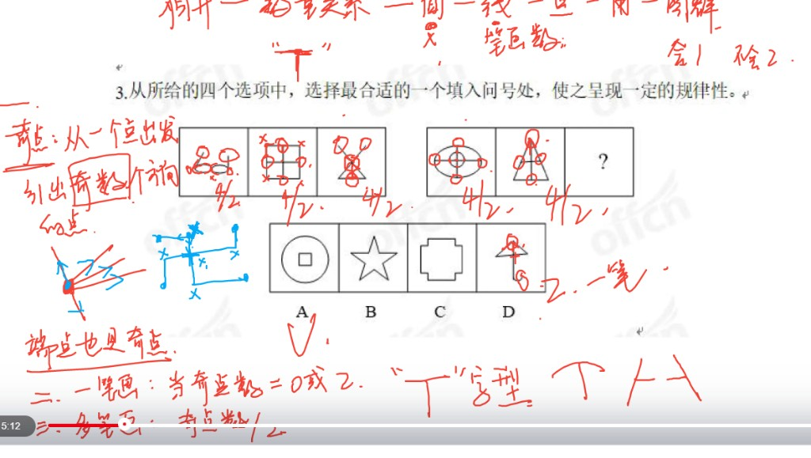

# 图形推理 · 速记笔记

| 步骤 | 判断 | 去哪 |
|------|------|------|
| **① 认形式** | 题怎么摆（顺推 / 类比 / 九宫格 / 分组 / 空间） | **一** |
| **② 看长什么样** | 特殊图 | **二** |
| | 长得像（相似） | **三** |
| | 长得不像（相异）：几何 → 数量 → 相对位置 | **四** |

---

# 一、认形式

| 形式 | 长什么样 | 注意 |
|------|----------|------|
| **顺推** | 一组图从左到右，问号在末尾 | 整组同一规律或递变 |
| **类比** | 图1∶图2∶图3，或两段类比 | 前两图怎么变出第三图，再套问号 |
| **九宫格** | 3×3，问号在一格 | 按行或按列同一套规律 |
| **分组分类** | 6 个图分成两组 | 每组一个规律，两组能分开 |
| **空间类** | 折叠、三视图、截面、立体拼接 | 和平面规律分开想；展开图最常见 |

---

# 二、特殊图

**先分流**：长得特殊时走专口，先别硬套面 / 叠加。

## （一）黑白格 ★

黑块、白块（圆、方、格点涂黑）时，**先比个数和形状**：

- **个数、形状一致** → 旋转、移动；遍历（空白格也要看）
- **个数或形状不一致** → 对称性；部分数（连着的黑算一块）

## （二）小图形 ★

心、圆、三角等小块拼在一起，当**元素**看。

| 考法 | 问什么 |
|------|--------|
| **个数** | 一共几个（或每种几个） |
| **种数** | 有几种不同形状 |
| **行数 / 列数** | 九宫格、矩阵里按行或按列数 |
| **元素代换** | 某一种换成另一种，个数或位置对应 |
| **遍历** | 每幅同样几种，只是个数/位置变 |

## （三）立体

小黑点、箭头多半在**指定方向或位置**。正方体展开、三视图、截面和平面规律分开想。

### 相对面（正方体）★

相对面 = 折好后**不相邻、碰不到边**的一对面。立体图里**不可能同时看见**一对相对面 → 同时出现就排除。

| 找法 | 怎么认 |
|------|--------|
| **同行/同列隔一个** | `A-B-C` → A 与 C 相对；`A-B-C-D` → A 与 C、B 与 D 相对 |
| **Z / 反 Z 两端** | 呈 Z 字时，两端两面相对 |
| **剩下一对** | 正方体共 3 对相对面；找出两对后，剩下两个一定相对 |

做题顺序：展开图标出三对相对面 → 选项里相对面同时出现则错 → 再看相邻面公共边、图案朝向（画箭头）。

四面体没有相对面（每面都相邻）；相对面主要用在正方体纸盒折叠。

折不成的展开图一眼排：田字格（2×2）、一排超过 4 个面、某面周围超过 4 个邻面。

---

# 三、相似

整体轮廓像、零件差不多 → **不要先数数量**。

零件全同 → 转、翻、挪
同中有异 → 叠加

## （一）转动和移动 ★

零件完全一样，只变方向 / 位置。

| 考点 | 怎么动 | 注意 |
|------|--------|------|
| **旋转** | 图形**整体**顺 / 逆时针转 | 转角可恒定或递增（如 45°、90°、135°） |
| **翻转** | **左右**或**上下**翻 | 成镜像，和旋转不是一回事 |
| **移动** | 小元素上下左右或顺逆时针挪 | 盯：哪个元素、方向、步数（可恒定或递增） |

## （二）叠加 ★

轮廓像、线条有增减。常出类比或九宫格（按行 / 列同一套加法）。

| 考点 | 怎么合 |
|------|--------|
| **直接叠加** | 保留原图形所有元素 |
| **去同存异** | 去掉相同，保留不同 |
| **去异存同** | 去掉不同，保留相同 |
| **规律叠加** | 按规律合（如黑+黑=白）；先列运算表再套 |

---

# 四、相异

整体不相似、元素也不同 → **不要硬套旋转叠加**。

优先顺序：**几何特性** → **数量** → **相对位置**。  
几何内部再按：**对称 → 直曲 → 直角**，还可开闭。  
数量内部再按：**面 → 部分 → 素 → 线 → 点**。

## （一）几何特性 ★

### 1. 对称

一组可都轴对称，或「轴 / 中心 / 既轴又中心」按格变；轴对称还可数**轴的条数**（恒定或递减）。

| 类型 | 判定 | 还考什么 |
|------|------|----------|
| **轴对称** | 沿一条直线对折，两边完全重合 | **轴的条数、方向**（横 / 竖 / 斜） |
| **中心对称** | 绕某点转 **180°** 与原图重合 | 有没有对称中心 |
| **既轴又中心** | 两条互相垂直的对称轴 ⇒ 一定中心对称 | 矩形、平行四边形要细看 |

### 2. 直曲

一组可都同一类，或「直、曲、直曲」依次出现。

| 类型 | 含义 |
|------|------|
| 全直线 | 只有直线 |
| 全曲线 | 只有曲线 |
| 直曲结合 | 既有直线又有曲线 |

### 3. 直角

只数两条**直线**垂直形成的 90°；曲线拐弯、锐角钝角都不算。

### 4. 开闭

| | 判定 |
|--|------|
| **封闭** | 能圈住，从缺口走不出去 |
| **开放** | 有缺口，能沿线条走出图形 |
| **半开半闭** | 外封内开或局部开口 |

## （二）数量

规律常见：恒定、递增 / 递减、奇偶、运算（和差倍）、相邻作差。

### 1. 面 ★

黑色线条围起的**白色区域**才算一面。涂黑块一般不当白面；公共边隔开的各算各的。

### 2. 部分

黑色线条**连在一起**算 1 个部分；断开各算各。看「连不连」，不看「像不像」。

### 3.图群

小块多、彼此分开 → 回**二 · 小图形**：种数、个数、行列、代换。

### 4. 线

可数：所有线条、直线 / 曲线；还可分横竖、内外。相交处断开再数「线段」；
一笔画另说。

### 5. 点

可数：所有交点、直曲交点、内外交点。端点、切点有时单独考；切点也是交点的一种。

一笔画

**奇点**：从该点引出的线的条数为**奇数**（1、3、5…）。**端点也是奇点**（只引出 1 条）。

| 怎么算 | 规则 |
|--------|------|
| 数奇点 | 逐个点看「引出几条线」；奇数 → 奇点（T 字交叉常是 3，必奇） |
| 一笔画 | 奇点数 = **0 或 2** |
| 多笔画 | 笔画数 = **奇点数 ÷ 2** |

## （三）相对位置

谁在谁里、相邻、连接、上下左右。
