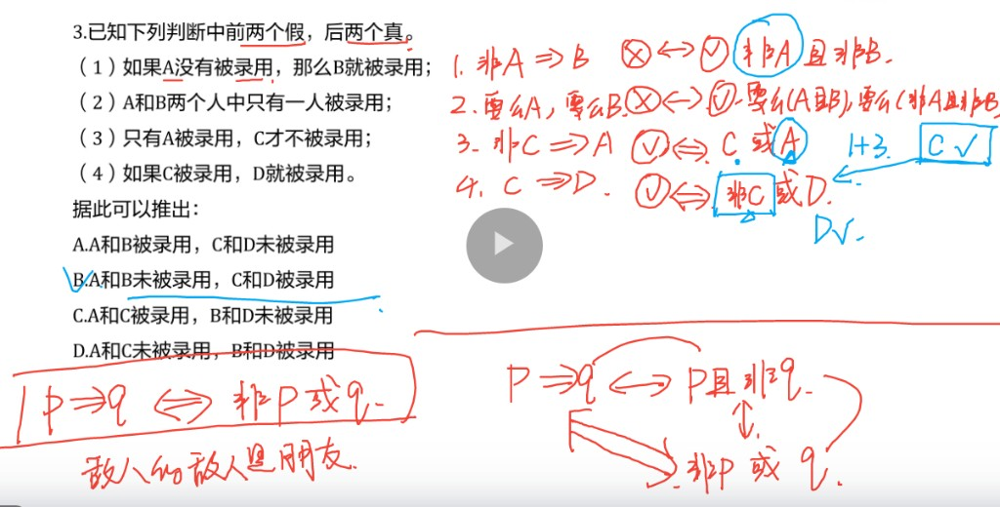
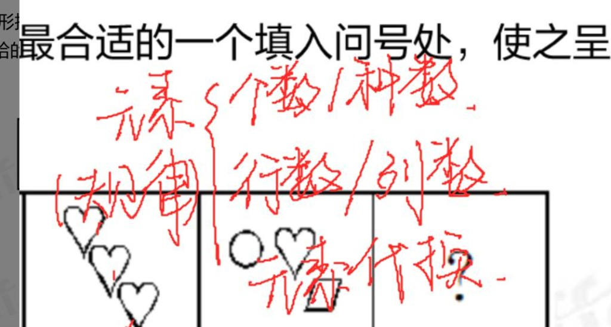
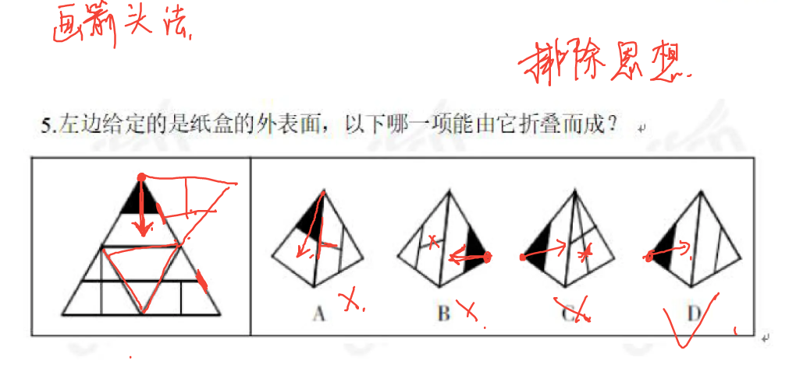
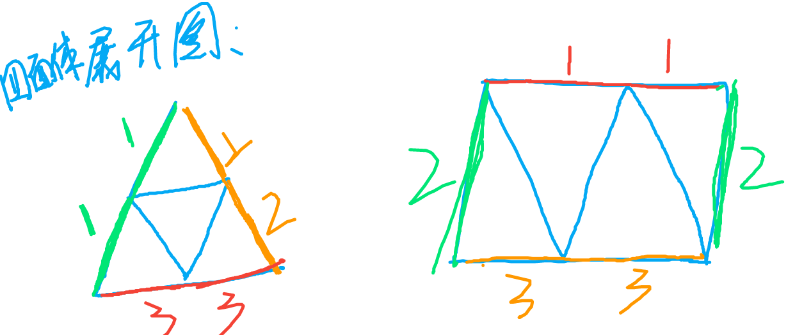
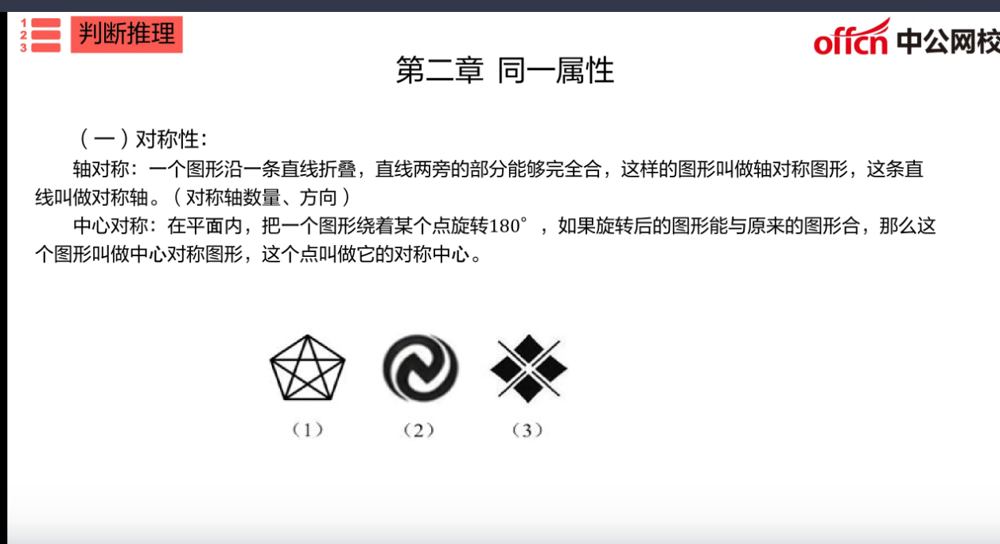
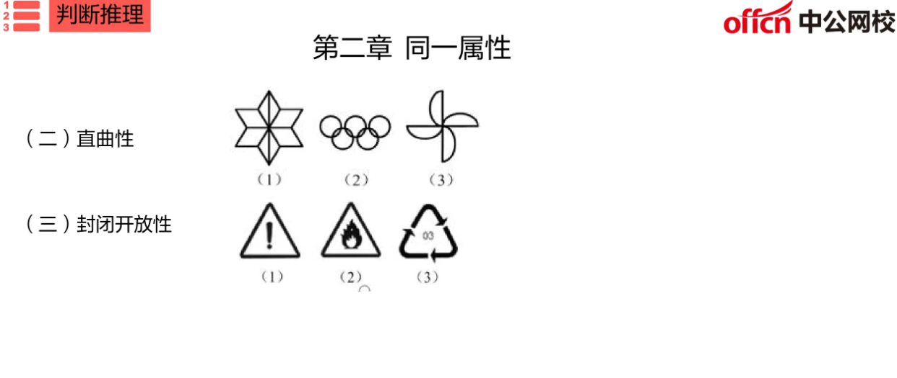
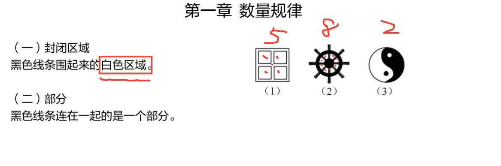
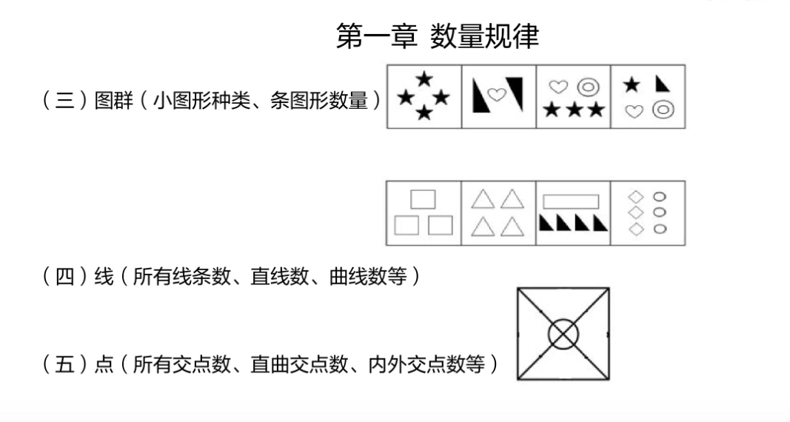
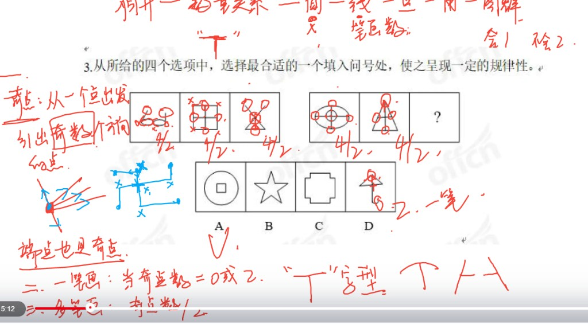

# 职测笔记 · 生成源（勿当日常阅读稿）

> **你日常看的是 Word / Excel**（同名 .docx / .xlsx）。  
> 本文件只给 AI / 导出脚本用：改这里 → 运行 导出Word.py / 导出Excel.py → 生成文档。  
> 用分隔标记切分各科：`<!-- stem:文件名 | out:docx|xlsx -->`


<!-- stem:言语理解笔记 | out:docx -->

# 言语理解 · 速记笔记

总流程：**读问法 → 定题型 → 看行文脉络**（盯关键词）

注意：只有**细节题**「先看选项」；其余题先析材料。

| 步骤 | 判断 | 去哪 |
|------|------|------|
| **① 定题型** | 填空 / 片段 / 语句 | **一** |
| **② 逻辑填空** | 语境 + 词语辨析 | **二** |
| **③ 片段阅读** | 主旨 / 细节 / 标题 / 词句 / 文章 | **三** |
| **④ 语句表达** | 排序 / 填空 / 推断上下文 | **四** |

---

# 一、题型地图 ★

| 题型 | 常见问法 | 核心打法 |
|------|----------|----------|
| **逻辑填空** | 填入划横线最恰当 | 语境 + 词语辨析 |
| **片段阅读** | 主旨（归纳 / 意图）/ 细节 / 标题 / 词句 / 文章阅读 | 归纳靠**行文结构**；意图先抓中心再推 |
| **语句表达** | 排序 / 填空 / 推断上下文 | 首句 → 代词 → 前后关系 → 捆绑（捆绑错易误导） |

---

# 二、逻辑填空

## （一）先定语境 ★

| 语境信号 | 怎么填 |
|----------|--------|
| **转折**（但是、却、然而） | 前后**相反** |
| **递进**（甚至、更、不仅…还） | 后空**程度更重** |
| **并列**（、；和；既…又） | **词性、色彩、结构**一致 |
| **因果**（因此、导致、由于） | 能推出结果 / 能作原因 |
| **解释**（即、也就是、冒号、破折号） | 横线 ≈ 前后解释 |

解释说明补充：提示是**句子** → 空填理解概括/推断；提示是**词语** → 空填语义近、或解释其功能特点。

## （二）实词常辨

| 角度 | 问自己 |
|------|--------|
| **侧重点** | 强调对象 / 方式 / 结果是否一样 |
| **范围** | 大词套小词会空 |
| **搭配** | 能否跟前后名词、动词习惯搭配 |
| **语体** | 书面 vs 口语；褒 vs 贬 vs 中性 |

## （三）成语常辨

| 易错 | 记住 |
|------|------|
| 望文生义 | 别只看字面（如「不刊之论」= 不可改，不是不能登） |
| 褒贬用反 | 先定文段态度再选 |
| 对象错配 | 对人 / 对事 / 对己是否匹配 |
| 程度不当 | 轻微问题不用过重成语 |

## （四）作答顺序

先做最有把握的一空（有强关联词的），排除后再比剩下。

1. 语感建立在**语境分析 + 词语辨析**上  
2. 相信第一感觉，少反复改  
3. 从易懂空、成语空入手  
4. **整体验证**，不能只凭一空定答案  

---

# 三、片段阅读 ★

## （一）主旨题

| 类型 | 常见问法 | 核心 |
|------|----------|------|
| **概括归纳** | 主旨是 / 主要说明了 / 概括最准确 | 先定**行文结构**，再定主旨落点 |
| **判断意图** | 意在说明/强调；道理/启示 | 有观点 → 抓主旨句；无观点 → **推断**意图 |
| **阅读敏感** | 各类主旨都用 | 关键词 + 关键句加速抓观点 |

### 1. 析材料共用四步

结构定错，重点就偏。从宏观到微观：先扣主旨，再抠表述。

1. 理解句义  
2. 概括句作用（背景、介绍、事例、问题、论证、对策、原因、危害）  
3. **定行文结构、定重点**（利用关联词）  
4. 总结概括  

析选项：**正向选**（是否符合主旨）→ **反向排除**（代入原文是否一致）。  
先看选项**主体**是否与文段对象一致；主体错直接排除。

### 2. 行文结构（必背）★

读文先辨结构；结构对了，主旨落点就对了。

| 结构 | 主旨落点 | 提示 / 做法 |
|------|----------|-------------|
| **总分** | 前文话题（表述不全时以后文补全） | 后文展开勿把例子当主旨 |
| **提出—转折** | **转折后** | 但是、然而、实际上 |
| **分—总** | **尾句**（结论 / 对策 / 评价） | 总之、可见、综上所述 |
| **总—分—总** | 首尾同义，选概括全的 | — |
| **提出问题—对策** | **对策** | 应该、需要、必须 |
| **并列·同一对象** | 各方面**加和** | 同时、另外、此外 |
| **并列·不同对象** | 概括**共性** | 一方面…另一方面；分号 |
| **顺承·时间/事理** | 发展**全过程** | 年份推进；首先、然后、终于 |

分总常见行文：分析论述→结论；提出问题→解决问题；提出话题→给出评价。

### 3. 判断意图 · 怎么推

| 情形 | 怎么选 |
|------|--------|
| 多数情况 | **主旨 + 往前推一步**（启示、对策、评价） |
| 已有明确对策 | 选对策，不要只复述问题 |
| 纯分析现象 | 选概括，不要硬加对策 |

| 题干特征 | 答案落点 |
|----------|----------|
| **问题** + 不良影响 | **解决问题**的对策 |
| **问题** + 原因 | **针对原因**给对策 |
| **问题** + 原因 + 不良影响 | **针对原因**给对策 |
| **重要性** + 缺陷 | **弥补缺陷**的对策 |

有原因时：选针对原因的对策，勿选空泛「有待完善」。优先对策，勿只复述问题/危害。

例：流动人口「未能真正融入」→ 危害→ 影响长治久安 → 结构是问题→（隐含）对策；正确项对准「让流动人口真正融入城市」。

### 4. 阅读敏感

| 关键词 | 关键句 |
|--------|--------|
| 关联词（转折、因果） | **位置**：首尾 |
| 总结词 | **内容**：评价句、对策句 |
| 指代词（常接评价） | **形式**：问句、感叹句 |
| 强调词 / 假设、条件词 | |
| 引导观点的词语 | |

选项辨析：① 找差别（主体、对策/原因、程度）② 回原文核对。  
话题可能不唯一；同一含义可有不同表述。

---

## （二）细节题 ★

仅细节题「先看选项」。

1. 确认细节题  
2. 先看选项，勾画易错标志（绝对、比较、因果、范围、时态）  
3. 再看材料，逐项找原文对应  

| | 设错 | 敏感词 / 怎么认 |
|--|------|-----------------|
| **无** | 无中生有 | 新概念；或借原文**凭空捏造** |
| **错** | 概念变化 | 范围/程度/趋势/时态；偷换、扩缩、缺限定 |
| **反** | 正话反说 | 肯/否定词 |
| **混** | 逻辑乱 | 因果、比较、条件词（导致、因为、大于、只有…才） |

| 错 · 概念变化 | 例 |
|---------------|-----|
| 内涵改变 | 喜欢吃苹果 → 喜欢吃香蕉 |
| 扩大范围 | 小明是渣男 → 男人都渣 |
| 缺少限定 | 丢掉「如果…」等条件 |

绝对词大概率错；坚持选最优、从弱（表述更稳、限定更准优先）。

---

## （三）标题选择

先析文段，再比选项：

1. **紧扣主旨**：无主题不选  
2. **全面完整**：残缺不选  
3. **形象生动**：不醒目慎选  

含主题词、不偏不怪；文艺过空、标题党排除。  
正向选（符合主旨且较生动）→ 反向排除（代入原文是否一致）。

---

## （四）词句理解

| | 类型 |
|--|------|
| **词语理解** | 指代类 / 修辞类 / 概念类 |
| **句子理解** | 主旨句 / 修辞句 |

| 类型 | 步骤 |
|------|------|
| **指示代词** | 定位 → **就近** → 结合语境 → 概括 |
| **概念词** | 定位 → **找相关信息** → 综合归纳 |
| **比喻词** | 定位 → **找本体** → 结合喻体特点 → 概括 |
| **主旨句** | 定位 → **抓关键词** → 揣摩句义 |
| **修辞句** | 定位 → **辨修辞** → 思考意图 |

「简而言之」里的「之」：看**后面**（后面才是概括）。

---

## （五）文章阅读

一篇长文多问。先通读抓结构/主题，再按小题套前面打法；细节仍可先看选项。

解题顺序：读问题 → 看材料 → 做题目。

答题顺序：① 先残缺再完整　② 先部分后整体　③ 先明确后模糊。

| 方法 | 用法 |
|------|------|
| **眉批法** | 每段用短话概括，便于定位 |
| **勾画法** | 勾与题相关内容 |
| **跳读法** | 人名、地名、书名、括号可跳，抓主干 |

技巧：跳读+精读；读懂了先做主旨/标题/推断/归位；读不懂先做填空/选词/词句（靠局部）；细节先做有指向的，再做全文查找的。

---

# 四、语句表达 ★

## （一）语句排序 ★

考点速递（三步）：

1. **看选项，分析选项差异**（首句不同、语句顺序不同等）  
2. **抓标志，确定语句顺序**（常用标志：关联词、指代词、顺序词、总结词等）  
3. **读文段，验证全文逻辑**（部分语句定答案后，仍要通读；看全文是否通顺、合适、合理）  

| | 句子特征 |
|--|----------|
| **不适合首句** | 指代词、转折词、总结词、并列词、具体分析 |
| **适合首句** | 引出话题、下定义、提出观点 |

定先后（捆绑/顺序）：指代词、关联词、重复词、顺序词、行文脉络。捆绑标错容易误导，要回读验证。

## （二）语句填空 ★★★

考点速递：横线句要与文段/前后句做到 **话题一致**、**思路一致**。  
思路：通过分析作者写作思路，推断横线处句子的意思。做题顺序：**找 → 推 → 选**（先找话题/结构，再推句意，最后选）。兼顾**宏—微**（整段话题 + 前后句衔接）。

| 横线位置 | 作用 |
|----------|------|
| **段首** | 总起，引出 |
| **段中** | 承上启下 |
| **段尾** | 总结（亦可对策） |

选项要：话题一致、思路一致、色彩一致、能接前后句。

## （三）推断上下文

| 看什么 | 做什么 |
|--------|--------|
| **尾句分析** | 下文接尾句落点的话题 |
| **行文分析** | 总分、问题→分析→对策等，关注**全文**结构 |
| **选项分析** | 接着话题往下说；排除已述、换题、总结全文 |

步骤：看问法（上/下文）→ 推下文盯**尾句话题**顺着说 → 推上文盯**首句**（指代、关联后半、结论）→ 结构题不能只看一句。

排除：已说过的；突然换话题；总结全文（那是上文）；只顺着中间例子写（没跟尾句）。


<!-- stem:判断推理笔记 | out:docx -->

# 判断推理 · 速记笔记

> **上篇**形式逻辑｜**下篇**可能性推理（削弱 / 加强 · 解释等）｜**类比**词语关系｜**定义**要件比对

---

# 上篇 · 形式逻辑

**做题**：翻译 → 定类型 → 套规则 → 只选「一定能推出」  
排除：否前、肯后、有些互推、两「有些」硬推。

## 一、四类命题

| 类型 | 形式 | 矛盾 | 核心用法 |
|------|------|------|----------|
| 直言 | 所有/某个/有些 A 是(非) B | 量词对调 + 肯否对调 | 所有 → 某个 → 有些（只可向下） |
| 联言 | p 且 q | 非p 或 非q | 「且」为**假**：一边真 → 另一边假 |
| 选言 | p 或 q | 非p 且 非q | 「或」为**真**：一边假 → 另一边真 |
| 假言 | p → q | p 且 非q | 肯前肯后、否后否前 |

**直言**：找矛盾＝所有↔有些，且是↔非（两步一起改）。  
`所有 → 某个 → 有些` 可向下；**有些是 ≠ 有些非**。

**联言 / 选言**

| | 联言（且） | 选言（或） |
|--|-----------|-----------|
| 推理 | 「且」假：一边真→另一边假 | 「或」真：一边假→另一边真 |
| 例 | 又高又帅假；高真→帅假 | 考公或考研真；没考公→必考研 |

选言分两种（**不是同一概念**）：

| | **相容选言**：p **或** q | **不相容选言**：**要么** p，**要么** q |
|--|--------------------------|----------------------------------------|
| 含义 | 至少一个真；**可同时真** | **恰好一个**真；不可兼得 |
| 两边都真 | **真** | **假** |
| 一边假 | 另一边必真 | 另一边必真 |
| 一边真 | 另一边可真可假 | 另一边必假 |
| 例 | 考公或考研（两个都考也成立） | 要么考公，要么考研（只能一条路） |

**假言 ★**

```
p → q  ＝  非q → 非p     （逆否等价）
p → q  ＝  非p 或 q
假言为假：p 且 非q
```

| | 规则 | 例：下雨 → 地湿 |
|--|------|------------------|
| ✅ | 肯前 → 肯后 | 下雨了 → 地一定湿 |
| ✅ | 否后 → 否前 | 地不湿 → 一定没下雨 |
| ❌ | 否前 | 没下雨 → 地不一定干 |
| ❌ | 肯后 | 地湿了 → 不一定下过雨 |

---

## 二、关联词速查

> 三段论与前提型合在一起，见下篇「八 · 1. 前提型」。

| 说法 | 逻辑 |
|------|------|
| 如果 / 只要 p 就 q | p → q |
| 只有 q 才 p；除非 q 否则非 p | p → q（q 是必要条件） |
| p 是 q 的充分 / 必要条件 | p→q / q→p |
| 既 p 又 q | p 且 q |
| p 或者 q | 相容或 |
| 要么 p，要么 q | 不相容或（恰一个） |

---

## 三、真假话综合例 ★

**题眼**：已知若干句真/假 → **假的取矛盾，真的按规则推**（假言假＝前真后假）。

**例**（前两假、后两真；问谁被录用）

| # | 原句 | 翻译 | 真假 | 推出 |
|--|------|------|------|------|
| ① | 如果 A 没录用，那么 B 就录用 | 非A → B | 假 | **非A 且 非B** |
| ② | A、B 中只有一人录用 | 恰一（要么） | 假 | 同真或同假（与①一致：都未录用） |
| ③ | 只有 A 录用，C 才不录用 | 非C → A | 真 | 逆否：非A → C → **C 录用** |
| ④ | 如果 C 录用，D 就录用 | C → D | 真 | 肯前 → **D 录用** |

结论：A、B 未录用，C、D 录用。



---

# 下篇 · 可能性推理（削弱 / 加强）

## 四、常见论证模型 ★

包含：**求异论证**、**溯因论证**、**实践论证**、**双观点**、**类比推理**、**枚举归纳**、**数据论证**。  

### 1. 求异论证

**是什么**：通过**对比**实验、调查，得出**因果关系**。

思路：两组其他条件差不多，只有一个因素不同，结果也不同 → 该因素就是原因。

| | 小李 | 小王 |
|--|------|------|
| 相同 | 湖南人、成绩好 | 湖南人、成绩好 |
| 结果不同 | **身体好** | **身体不好** |
| 因素不同 | **爱运动** | **不爱运动** |

结论：爱运动 → 身体好。

| 方向 | 怎么打 |
|------|--------|
| **削弱** | ① 两组对象有其他**不同属性**；② **因果倒置** |
| **加强** | ① 两组对象有其他**相同属性**；② **解释因果** |

### 2. 溯因论证

**是什么**：发现一个**现象 A**，推测其产生的**原因 B**（结构：**因为 B，所以 A**）。

| | 内容 |
|--|------|
| 现象 A | 小李身体好 |
| 推测原因 B | 爱运动 |

结论：爱运动 → 身体好（由果推因）。

| 方向 | 怎么打 |
|------|--------|
| **削弱** | ① **否定此因**（不是因为爱运动）；② **另有他因**（身体好另有别的原因） |
| **加强** | ① **解释因果**；② **排除他因** |

### 3. 实践论证

**是什么**：**采取方案 A，达到目的 B**。

例：为了让**身体更健康**（目的 B），小李决定**多运动锻炼**（方案 A）。

| 方向 | 怎么打 |
|------|--------|
| **削弱** | ① **方案 A 不可实现**；② **达不到目的 B** |
| **加强** | ① **方案 A 可实现**；② **能达到目的 B** |

### 4. 双观点

**是什么**：针对同一现象的原因，有两个不同观点。

| | 说法 |
|--|------|
| 原观点 | **A** 是 B 的原因（压力大 → 小李脱发） |
| 反对者 | **C** 是 B 的原因（熬夜 → 小李脱发） |

**常见削弱反对者**：**A 是 C 的原因**（压力大 → 熬夜）→ A 才是**根本原因**，反对者被削。

### 5. 类比推理

**是什么**：两组对象有**相似属性**，据此认为还有**其他相似属性**。

| | 甲 | 乙 |
|--|----|----|
| 已知相似 | 女性、170、25 岁 | 女性、170、25 岁 |
| 推出 | 穿这件衣服**好看** | 也**好看**？ |

| 方向 | 怎么打 |
|------|--------|
| **削弱** | 找**根本不同属性** |
| **加强** | 找**根本相同属性** |

### 6. 枚举归纳

**是什么**：**样本**具有某种属性，认为**所有对象**都具有该属性。

例：从不透明盒子拿出 10 个球都是红色的 → 认为盒子里所有球都是红色的。

| 方向 | 怎么打 |
|------|--------|
| **削弱** | 样本不具有**代表性** |
| **加强** | 样本有**代表性** |

### 7. 数据论证

**是什么**：题干通过**数据对比**得出结论。

例：人行道上受伤人数是滑冰场的 **2 倍**（**绝对数**）→ 认为滑冰场**更安全**（**相对比**）。

陷阱：用绝对数推相对结论，忽略**环境比例（基数）**（两边总人数可能差很多）。

| 方向 | 怎么打 |
|------|--------|
| **削弱 / 加强** | **补充环境比例（基数）**，使结论不成立 / 成立 |

### 论证模型速查总表 ★

| 模型 | 削弱 | 加强 |
|------|------|------|
| **求异** | 其他不同属性；因果倒置 | 其他相同属性；解释因果 |
| **溯因** | 否定此因；另有他因 | 解释因果；排除他因 |
| **实践** | 方案不可实现；达不到目的 | 方案可实现；能达到目的 |
| **类比** | 根本不同属性 | 根本相同属性 |
| **枚举** | 样本无代表性 | 样本有代表性 |
| **数据** | 补基数→结论不成立 | 补基数→结论成立 |
| **双观点** | 削反对：根本原因 | — |

---

## 五、做题顺序 ★必背

**① 梳理主线**（先盯结论）

```
论据 → 论证 → 结论
```

定类型：是 **因果**（A 导致 B）？还是 **缺桥**（论据 AB、结论 AC）？

**② 选项定性**（对号入座）

| 削弱 | 加强 |
|------|------|
| 因果倒置 | 解释因果 |
| 另有他因 / 根本原因 | 排除他因 |
| 有因无果 | 有因有果 |
| 无因有果 | 无因无果 |
| 切断联系 | 建立联系 |

主观观点、空表态 → **直接排除**（没有用）。

**③ 选项比较**（多个都像对时）

1. 话题一致吗？（防**偷换概念**）  
2. **本质 > 举例**  
3. **直接 > 间接**

---

## 六、削弱 / 加强总表

### 因果关系类（结论：A 导致 B）

| 削弱（力度） | 加强（力度） |
|--------------|--------------|
| **因果倒置**（最大）· B→A | **解释因果**（最大）· 为何 A→B |
| **另有他因**（可能）· C→B | **排除他因**（间接） |
| **根本原因**（必然）· C 是根本因 | — |
| **有因无果**（举例） | **有因有果**（举例） |
| **无因有果**（举例） | **无因无果**（举例） |

### 缺桥类（论据 AB；结论 AC）

| 削弱 | 加强 |
|------|------|
| **切断联系**（切断 BC）· 容易出错 | **建立联系**（补上 BC） |

---

## 七、无效选项

| 类型 | 例 | 为何没用 |
|------|-----|----------|
| 主观观点 | 我认为 / 大家都觉得 / 某人支持 | 只表态，不动论证 |
| 空权威 | 专家说对（不给理由） | 没解释、没拆桥/建桥 |
| 情感评价 | 不好 / 很有意义 | 态度 ≠ 逻辑 |
| 无关项 | 沾边但不打 A→B 或 BC | 推不动结论 |

---

## 八、前提 / 解释 / 结论 / 评价型 ★

### 1. 前提型 · 三段论 ★

**题干问法**（盯「前提 / 假设」）

- 上述论证还需基于以下哪一**前提 / 假设**？
- 要使上述推断成立，必备的前提 / 假设条件**不包括**：

核心：**前提 = 必要条件**（结论成立的前提 = 结论成立的必要条件）。

补前提常用两种思路：**搭桥法**、**三段论**。

#### （1）搭桥法

| | 符号 | 例 |
|--|------|-----|
| 论据 | A B | 小李学逻辑 |
| 结论 | A C | 小李有对象 |
| **补前提** | **B C** | 学逻辑的人有对象 |

搭桥：建立论据与结论间**跳跃概念**的联系（B 与 C）。

#### （2）三段论

中间概念当**桥**：桥稳才能必然推出；缺前提时补全中间桥。

```
所有土木生 → 工科生；小明 → 土木生  ⇒  小明 → 工科生 ✅
```

**优先画圈**：怎么画都对 → 能推；有的对有的不对 → 推不出。

| 硬规则 | 含义 |
|--------|------|
| 两个「有些」 | 一律推不出 |
| 「有些」↛「所有」 | 个别推不出全体 |
| 两个「不是」↛「是」 | 两否不得肯定 |
| 所有 A 是 B + 某人是 A | → 某人是 B（最常见能推） |

做题：翻译 → 画圈 → 见两「有些」直接排除。  
（周延＝说全了这一类；中项至少周延一次＝桥被说全过。）

### 2. 解释型

**题干问法**（盯「能解释」）

- 以下哪项如果为真，**（不）能解释**上述现象？
- 以下哪项如果为真，**最（不）能解释**上述现象？

**做题要点**

1. 解释题干中**看似不合理的现象**  
2. 全面、准确概括**转折词前后**，确定解释对象  
3. 正确选项应是题干现象产生的**原因**

### 3. 评价型

**题干问法**（结构 / 谬误是否相似）

- 下列选项中所犯**逻辑错误**与上述推理最为相似的是：
- 下面句子**逻辑表述方法**与所给题干一致的是：
- 以下哪项的**逻辑结构**与题干的最为类似？
- 以下哪项与题干中的**论证方式**相同？
- 下列最能说明上述推理**不成立**的是：

**解题思路**

| 题干类型 | 怎么抽 |
|----------|--------|
| **必然性推理** | 提炼**逻辑形式** |
| **可能性推理** | 概括**论证模型** |

**解题策略**

1. **提炼**题干的推理形式，或概括论证过程、逻辑谬误  
2. 对比选项，找出**相似性最强**或**最弱**的选项

### 4. 结论型

**题干问法**（能不能推出）

- 根据以上表述，下列判断**一定正确**的是：
- 由此可以推出：
- 下面哪一个结论最能被上面的论述**支持**？

核心：判断选项是否能根据**题干信息**得出。

**解题思路**：**定位原文 → 判断正误**。

---

## 九、类比推理（词语关系）★

> 不同于论证模型「类比」：这里是**词与词的关系**。  
> 总纲：**横向观察找关系；常态思维进去比。** 顺序：三大类 → **先含义后结构** → 常识细比。

### 一页速查（关系 + 二次辨析）

| 大类 | 关系 | 二次辨析 | 例 |
|------|------|----------|-----|
| **逻辑·概念** | 全同 | 同一所指 | 老鼠：耗子 |
| | 全异 | **反对/矛盾**；命名维度；有无中间态 | 黑白 / 曲直 |
| | 交叉 | 维度不同可重叠 | 博士：女士 |
| | 包含 | 个体/集合；**自然/人工** | 苹果：水果 |
| **逻辑·时序** | 因果 | 结果**好坏** | — |
| | 顺承 | **主客体**一致；常考**三词型**时间链 | 质疑判罚∶提出申诉∶改变判罚 → 急诊入院∶安排手术∶康复出院 |
| | 条件 | **必要/充分** | — |
| **言语·含义** | 近义 | **色彩、轻重**；词性 | — |
| | 反义 | **色彩**；词性 | 非常/非难 |
| | 释义/指代 | 解释、象征 | 青松：坚韧 |
| **言语·结构** | 偏正 | 形+中心语 | — |
| | 动宾 | 动+客体 | 实力：展示 |
| | 主谓 | 主+动/形 | 阳光：明媚 |
| | 并列 | **内部结构**一致 | 下棋：书画 |
| **经验常识** | 组成 | 核心/非核心；**内/外** | 湖北：中国 |
| | 功能 | 主/次；时间；单/多 | 空调：暖气 |
| | 加工 | **物理/化学** | 布：衣 / 麦：酒 |
| | 命名 | **形材功意音** | — |
| | 特征 | 内/外 | 火→热 |
| | 职业 | 场所；工具；对象 | 医生：手术刀 |
| | 位置 | 所在 | 飞机：机场 |

成语看**目的是否实现**；同语素注意**比喻义**。

**顺承例（2026 上联考 A）**：质疑判罚∶提出申诉∶改变判罚  
→ 选：急诊入院∶安排手术∶康复出院（严格先后；主体一贯）。  
做题：先锁时间链 → 再对**主客体** → 排除顺序可颠倒、主体中途更换的项。

---

## 十、定义判断 ★

### 做题流程

```
看问法定义 → 圈要件 → 逐选项比对 → 排除
```

1. **先看问法**：问「属于」还是「不属于」；多定义先定位到问的那个定义；
2. **圈要件**：定义拆成一个个必要条件（要件），全部满足才属于；**一个不符就排除**；
3. **逐项比对**：先比容易的（主体、客体），再比难的（方式、结果）；
4. **拿不准回原文**：回定义里定位那个关键词再判。

### 要件清单（八要素）

| 要素 | 盯什么词 | 例 |
|------|----------|-----|
| **主体** | 谁来做（身份、机构） | 行政机关、企业、消费者 |
| **客体** | 作用于谁 / 什么 | 财物、他人、市场 |
| **目的** | 为了…（为了 / 旨在 / 以…为目的） | 为了牟利 |
| **方式** | 怎么做（通过 / 利用 / 采取 / 以…手段） | 以书面形式 |
| **条件** | 在什么前提下（当 / 在…过程中 / 紧急状态） | 不可抗力发生时 |
| **结果** | 造成什么（导致 / 使得 / 造成） | 造成经济损失 |
| **原因** | 为什么（由于 / 基于 / 鉴于） | 因经营需要 |
| **性质** | 定性表述 | 非法占有、无偿 |

不是每个定义都有八项——**抓定义里实际写到的要件**，别自己脑补。

### 目的 vs 结果（高频坑）★

| | 定义写法 | 选项要求 |
|--|----------|----------|
| **目的** | 旨在 / 为了 / 以…为目的 | **不要求真的实现**，有这个意图即可 |
| **结果** | 导致 / 造成 / 使得 | **必须实际发生** |

> 例：「旨在提高效率」——方案没提高效率也算符合；「导致伤亡」——没伤亡就不符合。

### 陷阱清单

| 陷阱 | 特征 | 例 |
|------|------|-----|
| **偷换主体** | 主体身份不符 | 定义「行政机关」，选项「事业单位」 |
| **方式偷换** | 手段对不上 | 定义「书面」，选项「口头」 |
| **范围扩大 / 缩小** | 量级对不上 | 定义「某些」，选项「所有」 |
| **无中生有** | 选项加了定义没有的要件 | 定义没提金额，选项强调金额 |
| **时间错位** | 阶段对不上 | 定义「事后」，选项「事前」 |

「不属于」题反过来用：**找一个要件不符，直接选**。

### 多定义

- **问哪个看哪个**：先定位目标定义，其他定义是干扰；
- 选项纠结、两个定义像时：把选项分别代进两个定义，看要件归哪边；
- 有的题一个选项横跨两个定义的要件——回目标定义原文找区别词。

### 生僻定义看不懂时

定义本身读不懂（法律、经济术语）：

1. **别死磕字面**，直接看选项，找**选项之间的差异点**；
2. 拿差异点回定义找对应关键词，只比这一处；
3. 差异点比对不过来时，选**和定义字面重合度最高**的（下策）。

### 例（要件比对示范）

**应急物流**：指为应对突发性自然灾害、公共卫生事件等**突发事件**（条件），对物资、人员等**进行紧急保障**（方式）的特殊物流活动。

| 选项 | 比对 | 判定 |
|------|------|------|
| A. 地震后向灾区紧急调运帐篷 | 突发事件 ✔ 紧急保障 ✔ | **属于** |
| B. 电商为促销大促加急发货 | 非突发事件 ✘ | 不属于 |
| C. 部队日常例行物资运输 | 无「紧急保障」✘ | 不属于 |
| D. 洪灾后政府拨付资金重建 | 是资金拨付，非物流活动 ✘ | 不属于 |

要件就两个（条件 + 方式），逐项对，不符即排。

**例（众筹 · 定义没写的要件就是排除依据）**：众筹 = 通过互联网发布筹款项目、实施方案、**投资回报**的资金募集方式。问哪个属于众筹：

| 选项 | 比对 | 判定 |
|------|------|------|
| A. 红十字会发布灾情呼吁捐款捐物 | 无**投资回报**，是慈善捐赠 ✘ | 不属于 |
| B. 毕业生网上发布创意求资金援助 | 无回报承诺，是个人求助 ✘ | 不属于 |
| C. 学校为患病学生发起募捐 | 无回报，是募捐 ✘ | 不属于 |
| D. 艺术家网络筹资，逐一兑现「展品收藏待遇」承诺 | 有**投资回报** ✔ | **属于** |

众筹 vs 捐赠 / 募捐 / 求助，分界就在**有没有回报**——定义要件「投资回报」一个词定生死。

---

*假言以「p→q = 非q→非p」为准；加强削弱打在「论据→结论」上；定义判断要件全中才属于，「不属于」找一处不符即可。*


<!-- stem:图形推理笔记 | out:docx -->

# 图形推理 · 速记笔记

| 步骤 | 判断 | 去哪 |
|------|------|------|
| **① 认形式** | 题怎么摆（顺推 / 类比 / 九宫格 / 分组 / 空间） | **一** |
| **② 看长什么样** | 特殊图 | **二** |
| | 长得像（相似） | **三** |
| | 长得不像（相异）：几何 → 数量 → 相对位置 | **四** |

---

# 一、认形式

| 形式 | 长什么样 | 注意 |
|------|----------|------|
| **顺推** | 一组图从左到右，问号在末尾 | 整组同一规律或递变 |
| **类比** | 图1∶图2∶图3，或两段类比 | 前两图怎么变出第三图，再套问号 |
| **九宫格** | 3×3，问号在一格 | 按行或按列同一套规律 |
| **分组分类** | 6 个图分成两组 | 每组一个规律，两组能分开 |
| **空间类** | 折叠、三视图、截面、立体拼接 | 和平面规律分开想；展开图最常见 |

---

# 二、特殊图

**先分流**：长得特殊时走专口，先别硬套面 / 叠加。

## （一）黑白格 ★

黑块、白块（圆、方、格点涂黑）时，**先比个数和形状**：

- **个数、形状一致** → 旋转、移动；遍历（空白格也要看）
- **个数或形状不一致** → 对称性；部分数（连着的黑算一块）

## （二）小图形 ★

心、圆、三角等小块拼在一起，当**元素**看。



| 考法 | 问什么 |
|------|--------|
| **个数** | 一共几个（或每种几个） |
| **种数** | 有几种不同形状 |
| **行数 / 列数** | 九宫格、矩阵里按行或按列数 |
| **元素代换** | 某一种换成另一种，个数或位置对应 |
| **遍历** | 每幅同样几种，只是个数/位置变 |

## （三）立体

小黑点、箭头多半在**指定方向或位置**。正方体展开、三视图、截面和平面规律分开想。



### 相对面（正方体）★

相对面 = 折好后**不相邻、碰不到边**的一对面。立体图里**不可能同时看见**一对相对面 → 同时出现就排除。

| 找法 | 怎么认 |
|------|--------|
| **同行/同列隔一个** | `A-B-C` → A 与 C 相对；`A-B-C-D` → A 与 C、B 与 D 相对 |
| **Z / 反 Z 两端** | 呈 Z 字时，两端两面相对 |
| **剩下一对** | 正方体共 3 对相对面；找出两对后，剩下两个一定相对 |

做题顺序：展开图标出三对相对面 → 选项里相对面同时出现则错 → 再看相邻面公共边、图案朝向（画箭头）。

四面体没有相对面（每面都相邻）；相对面主要用在正方体纸盒折叠。



折不成的展开图一眼排：田字格（2×2）、一排超过 4 个面、某面周围超过 4 个邻面。

---

# 三、相似

整体轮廓像、零件差不多 → **不要先数数量**。

零件全同 → 转、翻、挪
同中有异 → 叠加

## （一）转动和移动 ★

零件完全一样，只变方向 / 位置。

| 考点 | 怎么动 | 注意 |
|------|--------|------|
| **旋转** | 图形**整体**顺 / 逆时针转 | 转角可恒定或递增（如 45°、90°、135°） |
| **翻转** | **左右**或**上下**翻 | 成镜像，和旋转不是一回事 |
| **移动** | 小元素上下左右或顺逆时针挪 | 盯：哪个元素、方向、步数（可恒定或递增） |

## （二）叠加 ★

轮廓像、线条有增减。常出类比或九宫格（按行 / 列同一套加法）。

| 考点 | 怎么合 |
|------|--------|
| **直接叠加** | 保留原图形所有元素 |
| **去同存异** | 去掉相同，保留不同 |
| **去异存同** | 去掉不同，保留相同 |
| **规律叠加** | 按规律合（如黑+黑=白）；先列运算表再套 |

---

# 四、相异

整体不相似、元素也不同 → **不要硬套旋转叠加**。

优先顺序：**几何特性** → **数量** → **相对位置**。  
几何内部再按：**对称 → 直曲 → 直角**，还可开闭。  
数量内部再按：**面 → 部分 → 素 → 线 → 点**。

## （一）几何特性 ★

### 1. 对称

一组可都轴对称，或「轴 / 中心 / 既轴又中心」按格变；轴对称还可数**轴的条数**（恒定或递减）。



| 类型 | 判定 | 还考什么 |
|------|------|----------|
| **轴对称** | 沿一条直线对折，两边完全重合 | **轴的条数、方向**（横 / 竖 / 斜） |
| **中心对称** | 绕某点转 **180°** 与原图重合 | 有没有对称中心 |
| **既轴又中心** | 两条互相垂直的对称轴 ⇒ 一定中心对称 | 矩形、平行四边形要细看 |

### 2. 直曲

一组可都同一类，或「直、曲、直曲」依次出现。



| 类型 | 含义 |
|------|------|
| 全直线 | 只有直线 |
| 全曲线 | 只有曲线 |
| 直曲结合 | 既有直线又有曲线 |

### 3. 直角

只数两条**直线**垂直形成的 90°；曲线拐弯、锐角钝角都不算。

### 4. 开闭

| | 判定 |
|--|------|
| **封闭** | 能圈住，从缺口走不出去 |
| **开放** | 有缺口，能沿线条走出图形 |
| **半开半闭** | 外封内开或局部开口 |

## （二）数量

规律常见：恒定、递增 / 递减、奇偶、运算（和差倍）、相邻作差。

### 1. 面 ★

黑色线条围起的**白色区域**才算一面。涂黑块一般不当白面；公共边隔开的各算各的。



### 2. 部分

黑色线条**连在一起**算 1 个部分；断开各算各。看「连不连」，不看「像不像」。

### 3.图群

小块多、彼此分开 → 回**二 · 小图形**：种数、个数、行列、代换。



### 4. 线

可数：所有线条、直线 / 曲线；还可分横竖、内外。相交处断开再数「线段」；
一笔画另说。

### 5. 点

可数：所有交点、直曲交点、内外交点。端点、切点有时单独考；切点也是交点的一种。

一笔画

**奇点**：从该点引出的线的条数为**奇数**（1、3、5…）。**端点也是奇点**（只引出 1 条）。

| 怎么算 | 规则 |
|--------|------|
| 数奇点 | 逐个点看「引出几条线」；奇数 → 奇点（T 字交叉常是 3，必奇） |
| 一笔画 | 奇点数 = **0 或 2** |
| 多笔画 | 笔画数 = **奇点数 ÷ 2** |



## （三）相对位置

谁在谁里、相邻、连接、上下左右。


<!-- stem:资料分析笔记 | out:docx -->

# 资料分析

## 基本概念

### （一）按数据的呈现形式划分

|       | 含义                       | 例子         |
| ----- | ------------------------ | ---------- |
| **量** | 有一定计量单位的绝对数，**有单位**      | 吨、kg、m²、亿元 |
| **率** | 两个相关的数在一定条件下的比值，**没有单位** | %、成、倍      |

### （二）按研究的内容划分

| 词       | 含义             |
| ------- | -------------- |
| **基期**  | 比较时作为参照标准的时期   |
| **现期**  | 与基期相比较的时期      |
| **基期值** | 描述基期的具体数值      |
| **现期值** | 描述现期的具体数值      |
| **增长量** | 现期值相对基期值增长的量   |
| **增长率** | 现期值相对基期值增长的百分比 |

---

## 一、速算四板斧

### 有效数字保留规则（总纲）★

| 运算     | 截几位      | 说明                               |
| ------ | -------- | -------------------------------- |
| **乘法** | **2 位**  | 两位×两位，结果量级靠估算卡住                  |
| **除法** | **3 位**  | 分子分母各留 3 位有效数字                   |
| **加法** | **3 位**  | 末位对齐，留 3 位有效数字                   |
| **减法** | **一般不截** | 相减会放大误差，直接精算；量级差很大时大数不动、只把小数量级补上 |

**两个配套动作：**

1. **四舍五入 + 同向截**：分子分母各自四舍五入，方向保持一致（都舍或都入），误差可以抵消一部分。  
   （**直接截断**只用于比大小，如差分法；算具体数值一律四舍五入。）

**截几位还要看选项差距**：首位不同 → 2 位够；首位相同第二位不同 → 3 位；前两位都相同 → 4 位或精算。

**选项差得远截得短，挨得近留得长。误差方向（用来卡选项）：**

| 截法        | 结果 |
| --------- | -- |
| 分子变小、分母变大 | 偏小 |
| 分子变大、分母变小 | 偏大 |

**两个坑：**

- 只截分母不截分子 → 误差全堆在分子上，反而更偏。
- 该 3 位却截 2 位，且选项首两位相同 → 算完两个选项重合，只能猜。

### 1. 截位直除（最常用）

$$
\frac{48562}{123478}\approx\frac{486}{1234}\approx 0.39
$$

### 2. 百化分（必背）

| 百分数                | 分数             | 百分数               | 分数        |
| ------------------ | -------------- | ----------------- | --------- |
| 16.7% / 14.3%      | 1/6、1/7        | 12.5% / 11.1%≈11% | 1/8、1/9   |
| 6.7% / 6.25%       | 1/15、1/16      | 9.1%≈9% / 8.3%    | 1/11、1/12 |
| 5.9% / 5.6% / 5.3% | 1/17、1/18、1/19 | 7.7% / 7.1%       | 1/13、1/14 |

> **连号一起背**：$\frac{1}{17}$、$\frac{1}{18}$、$\frac{1}{19}$ 对应 5.9%、5.6%、5.3%，分母每加 1，百分数约掉 0.3 个百分点；**个位越大、百分数越小**，考场按 5.9→5.6→5.3 顺着念就不会错位。

现期 480、增速 25% → 基期：

$$
\frac{480}{1+\frac{1}{4}}=480\times\frac{4}{5}=384
$$

### 3. 修正法 ★

**凑整修正**改数字是为了**算得快**，**差分法**改数字是为了**比得准**。一个求值、一个比大小，别混用。

#### 3.1 凑整修正（为了好除）

分母先加减成好约分的数，分子按同一比例同向修正。

| 操作   | 商会 | 分子怎么修 |
| ---- | -- | ----- |
| 分母加大 | 偏小 | 也加大   |
| 分母减小 | 偏大 | 也减小   |

**例 1（凑成整千，最好算）**：求 $\dfrac{4876}{1985}$

1. 分母 1985 只差 15 就到 2000（改动 0.75%），凑成 **2000**；
2. 分子同向加：$4876\times0.75\%\approx 37$ → $4913$；
3. $4913\div 2000=2.4565$（真值 $2.4564$）。

**例 2（凑成整百）**：求 $\dfrac{3560}{812}$

分母 812 凑成 **800**（减 12，1.5%），分子同向减 $3560\times1.5\%\approx 53$ → $3507$，$3507\div800=4.384$（真值 $4.3842$）。

**修正量怎么心算（关键：不用先估商）**：

$$
修正量=分子\times\frac{改动量}{分母}=分子\times 改动比例
$$

改动比例一般不到 2%，直接当百分数乘：$0.75\%$ 的 4876 ≈ $4876\times\frac{3}{400}\approx 37$，一步就出。

**两个要求，缺一不可**：

- **分母要凑成"移小数点"的数**：整千、整百、整十（2000、800、50）。凑成 1250 这种半吊子，照样得试商，等于白改。
- **改动幅度别超 2%**：改太多，修正量本身就要算半天，误差也补不回来。

#### 3.2 差分法（两分数很接近时，用来比大小）★

**用来干什么**：比较两个**分数大小**。当两个分数**分子都大、分母也都大**（谁同谁反用不上），又挨得很近、截位也分不出高下时，用差分法。

**差分怎么造**：大分数 − 小分数，**分子减分子，分母减分母**（不是分数值相减）。

设 $\frac{a}{b}>\frac{c}{d}$，则 差分数 $=\dfrac{a-c}{b-d}$（注意前提：$a>c$ 且 $b>d$）。

**三步走：**

1. 先粗判谁大，记为「大分数 / 小分数」；
2. 造出差分数；
3. **用差分数去和小分数比**——差分数只替代大分数上场，不替代小分数。

| 比较结果          | 结论                |
| ------------- | ----------------- |
| 差分数 **>** 小分数 | 大分数 **更大**（原方向不变） |
| 差分数 **<** 小分数 | 小分数 **更大**（方向反转）  |

**为什么成立**：$\dfrac{a}{b}=\dfrac{c+(a-c)}{d+(b-d)}$，而两个分数的「分子分母分别相加」所得的新分数，一定**夹在两者之间**。所以大分数必然落在「小分数」和「差分数」中间——只看差分数倒向哪边，就知道大分数在哪边。

**例（比重场景，截位也分不出）**：比较 $\dfrac{583}{4720}$ 与 $\dfrac{619}{5060}$

两个都比 10 多一点，截两位都是 0.12，直除也咬得很紧，直接上差分：

$$
\text{差分数}=\frac{619-583}{5060-4720}=\frac{36}{340}\approx 0.106,\qquad \frac{583}{4720}\approx 0.124
$$

差分数 0.106 < 小分数 0.124 → **方向反转** → $\dfrac{583}{4720}$ 更大（12.4% > 12.2%）。

> 好处：差分后分子分母都变成两位数，心算一步就完；硬算 583÷4720 要除到小数点后四位。

**注意**：

- 只有「分子大、分母也大」时才用；分子大分母小，直接判大，不需要差分。
- 差分数必须**更好算**（相减后位数少）才划算，减完还是三位数硬碰硬就换截位直除。
- 差分数和小分数若仍很接近，可再用一次差分，但一般一道题不超过两次。

### 4. 心算乘法

| 技巧                     | 例                                      |
| ---------------------- | -------------------------------------- |
| 5 结尾平方：前位×(前位+1)，后接 25 | $65^2=4225$                            |
| ×11：两数相加插中间（满 10 进位）   | $86\times11=946$                       |
| 5 结尾相乘：拆出 2 凑整十        | $15\times16=30\times8$                 |
| 百分数拆分                  | $\times35.8%\approx\times(33.3%+2.5%)$ |
| ×1.1 / ×0.9；高位先乘       | 对齐选项量级                                 |

估算顺序：先加减 → 再乘 → 再除。

---

## 比较方法解题思维 ★

### 一、加减法运算的比较（A ± B）

1. 数据**较小、较整**或为**百分数**时，可直接算完再比大小。
2. 数据**较大**时，算结果的**前几位有效数字**再比。

### 二、除法运算的比较（A / B）

1. 先看数字特点，能直接比就不算：
   - 分母相同 → **分子大**的分数大
   - 分子相同 → **分母小**的分数大
   - 分子分母**反向变化** → **分子大**的分数大
2. 横向或纵向看数字间的**倍数**或**变化幅度**。

### 三、乘除混合运算的比较（增长量）

比较 $\frac{A}{1+q_A}\times q_A$ 与 $\frac{B}{1+q_B}\times q_B$：

1. **现期大且增速也大** → 增量大，不用算；
2. **一大一小时** → 先看分母：$(1+q_A)$ 与 $(1+q_B)$ 的**倍数关系不足 1.5 倍**时，直接比较 $A\times q_A$ 与 $B\times q_B$；分母差得太远就直接比 $\frac{q}{1+q}$ 或精算。

> 两分数很接近、谁同谁反判不出来时 → 直接上 **3.2 差分法**（在「速算」一节，和凑整修正挨着，便于对照）。

---

## 核心公式

| 名称   | 公式                       | 怎么算                   |
| ---- | ------------------------ | --------------------- |
| 基期   | $B=\frac{A}{1+q}$        | 百化分 / 截位              |
| 现期   | $A=B\times(1+q)$         | 百化分乘法                 |
| 增长量  | $G=A\times\frac{q}{1+q}$ | **n+1 法则**            |
| 增长率  | $q=\frac{现-基}{基}=\frac{增长量}{基}=\frac{增长量}{现-增长量}$        | 截位直除                  |
| 比重   | $\frac{部分}{整体}$          | 截位直除                  |
| 比重增长量 | $\Delta=\frac{A}{B}\times\frac{q_A-q_B}{1+q_A}$ | 详见「四 · 比重」两步锁定选项 |
| 是几倍  | $\frac{A}{B}$            | 「多几倍」再减 1             |
| 平均数  | $\frac{总量}{个数}$          | 人均、亩产、日均等             |
| 平均数增长率 | $\frac{q_A-q_B}{1+q_B}$ | $q_A$ 总量增速、$q_B$ 份数增速；分母是 $1+q_B$ |
| 平均数增长量 | 现期平均数 $\times\frac{q_A-q_B}{1+q_A}$ | 和比重增量同一个套路 |
| 贡献率  | $\frac{A增量}{B增量}$        | 详见「四 · 贡献率 vs 拉动」     |
| 拉动增长 | $\frac{A增量}{B基期}$        | 用**百分点**               |

---

## 三、增长量 n+1 ★高频

当 $q\approx\frac{1}{n}$：

$$
G\approx\frac{A}{n+1}

(因为 G=A\times\frac{q}{1+q})
$$

**一般式**（百化分出来不是 $\frac1n$，而是 $\frac{n}{m}$ 时）：

$$
q\approx\frac{n}{m}\ \Rightarrow\ G=A\times\frac{q}{1+q}=A\times\frac{n}{m+n}
$$

- $n=1$：$A\times\frac{1}{m+1}$，就是上面的 n+1 法则（$q=\frac1m$）；
- $n>1$ 举例：$q\approx\frac27\approx28.6\%$ → $G=A\times\frac29$；$q\approx\frac38=37.5\%$ → $G=A\times\frac{3}{11}$。

例：$24.8%\approx25%=\frac{1}{4}$

$$
\frac{6485}{1+24.8%}\times24.8%
\approx\frac{6485}{5}
$$

记住：$q$ 变大，$\frac{q}{1+q}$ 变大；变小则变小。

$$
\frac{q}{1+q}=1-\frac{1}{1+q}
$$

---

## 四、分题型要点

### 基期 / 现期 / 增长率

- 基期除 $(1+q)$；**降幅**除 $(1-|q|)$
- 增长率例（截位直除）：

$$
\frac{25130-21546}{21546}
 
\frac{53852-46971}{46971}
$$

### 增长量

优先 n+1。比较大小：现期大且增速大 → 往往增量大；一大一小时比 $\frac{q}{1+q}$（分母倍数不足 1.5 倍时，直接比 $A\times q$，详见「比较方法 · 三」）。

**例（一大一小时）**：比较 $\dfrac{137.2}{1+17.9\%}\times17.9\%$、$\dfrac{366.5}{1+27.8\%}\times27.8\%$、$\dfrac{296.3}{1+31.3\%}\times31.3\%$

- 分母检查：$1.278\div1.179\approx1.08$、$1.313\div1.278\approx1.03$，都远不足 1.5 倍，直接比 $A\times q$ 安全；
- $366.5\times27.8\%\approx102$ ＞ $296.3\times31.3\%\approx93$ ＞ $137.2\times17.9\%\approx24.6$ → 第二个增量大。

$$
\frac{722.5}{1+13.6%}\times13.6%
 
\frac{6972.7}{1+12.1%}\times12.1%
$$

### 比重

**比重增长量（两期比重差，精确式）★**：部分现期 $A$、增速 $q_A$；整体现期 $B$、增速 $q_B$。

$$
\Delta=\frac{A}{B}\times\frac{q_A-q_B}{1+q_A}\quad(百分点)
$$

**两步锁定选项：**

1. **先定方向**：$q_A>q_B$ 比重升，$q_A<q_B$ 降（升降只看部分增速 vs 整体增速），先排除一半选项；
2. **再卡大小**：因为 $\dfrac{A}{B(1+q_A)}<1$，所以 $|\Delta|$ 一定 **小于 $|q_A-q_B|$ 个百分点**（粗估约 $(q_A-q_B)\times$ 基期比重）→ 先观察结果与 $q_A-q_B$ 的大小关系，结合选项常能直接锁定；
3. **还分不出**：结合数据特征灵活取舍——$\dfrac{A}{B(1+q_A)}$ 通常接近 1，$\Delta$ 略小于 $|q_A-q_B|$，选项普遍偏大时**选偏小**的那个。
   例：$q_A-q_B=70\%-40\%=30\%$ 个百分点，则 $|\Delta|<30$，选项里大于 30 的直接排除。

### 贡献率 vs 拉动

|      | 分子   | 分母       | 单位  |
| ---- | ---- | -------- | --- |
| 贡献率  | A 增量 | B **增量** | %   |
| 拉动增长 | A 增量 | B **基期** | 百分点 |

### 概念积累（材料里的冷门词）★

（拉动增长率、增长贡献率见上面「贡献率 vs 拉动」对照表）

| 概念 | 公式 | 易错提醒 |
|------|------|----------|
| 产销比 | **销量** ÷ 产量 | 分子是销量，别写反 |
| 行业亏损面 | 亏损企业数 ÷ 总企业数 | 是"家数"之比，不是亏损额之比 |
| 营业利润率 | 利润 ÷ 营业收入 | 分母是收入，不是成本 |
| 人口增长率 | 人口出生率 − 人口死亡率 | 是两个"率"相减，不是人数相减 |
| 周转量 | （人口总数 或 货物总数）× 周转距离 | 是**乘法**，别当除法 |
| 总资产 | 所有者权益 **+** 负债 | 是加法，不是相减 |
| 在校生人数 | 去年在校生人数 − 毕业人数 + 招生人数 | 流水账式递推（广东爱考） |

### 混合 / 隔年

- 混合增速：介于两边之间，靠近**基期量大**的一边
- 隔年（不能直接把两个增速相加）：

$$
(1+q_1)(1+q_2)-1\approx q_1+q_2+q_1q_2
$$

### 特征比例（粗估）

可用 $\frac{A}{B}$ 代替 $\frac{A}{B\pm a}$；增长率、比重中的 $\frac{A}{B+A}$ 可先用 $\frac{A}{B}$ 粗算。

**替代比大小（保序，可直接用）★**：比较 $\dfrac{A_1}{A_2\pm A_1}$ 与 $\dfrac{B_1}{B_2\pm B_1}$ 时，直接改比 $\dfrac{A_1}{A_2}$ 与 $\dfrac{B_1}{B_2}$——分子分母同加同减一个数，大小顺序不变，比出来的结论照用。

- 加法型（求增长率类）：$\dfrac{384}{423+384}$ vs $\dfrac{376}{413+376}$ → 比 $\dfrac{384}{423}$ vs $\dfrac{376}{413}$（0.908 vs 0.910，后者大）；
- 减法型（已知总量求部分占基期）：$\dfrac{236.5}{520.3-236.5}$ vs $\dfrac{293.3}{616.2-293.3}$ → 比 $\dfrac{236.5}{520.3}$ vs $\dfrac{293.3}{616.2}$（0.455 vs 0.476，后者大）。

> 好处：分母变成现期本身的量，不用先算加减，还常常把"分子分母都大"的僵局变成好比的数。

---

## 五、读材料 · 易错

**读材料**：时间单位、口径（全国/某省）、注释、同比/环比。

| 易错        | 记住             |
| --------- | -------------- |
| 多几倍 / 是几倍 | 多几倍要减 1        |
| 增长了 / 增长到 | 「了」=增幅；「到」=达到  |
| 百分点 / %   | 比重差、拉动用百分点     |
| 贡献率 / 拉动  | 增量÷增量 vs 增量÷基期 |
| 隔年增速      | 连乘，不是直接相加      |
| 局部当全年     | 前三季度 ≠ 全年      |


<!-- stem:常用公式 | out:docx -->

# 常用公式

| 一、增长 | 二、倍数 |
| --- | --- |
| **（一）求增长量**<br>增长量 = 现期值 − 基期值 = $\frac{现期值}{1+增长率}$ × 增长率 = 基期值 × 增长率<br>**（二）求增长率**<br>增长率 = $\frac{增长量}{基期值}$ × 100% = $\frac{现期值 − 基期值}{基期值}$ × 100%<br>= $\frac{增长量}{现期值 − 增长量}$ × 100%<br>**（三）求基期值**<br>基期值 = 现期值 − 增长量 = $\frac{现期值}{1+增长率}$ = $\frac{增长量}{增长率}$<br>**（四）求现期值**<br>现期值 = 基期值 + 增长量 = 基期值 × (1 + 增长率)<br>= $\frac{增长量}{增长率}$ × (1 + 增长率)<br>**（五）隔年增长率**<br>隔年增长率 = q1 + q2 + q1 × q2<br>**（六）年均增长**<br>年均增长量 = $\frac{末期值 − 初期值}{增长次数}$<br>年均增长率 q = n√($\frac{末值}{初值}$) − 1<br>增长次数：2014→2017 中间 3 次，n=3<br>估算（偏大，选小的）：$\frac{末/初 − 1}{n}$ = $\frac{总增量}{初值 × n}$ | **（一）求倍数**<br>是几倍 = $\frac{A}{B}$<br>多几倍 = 是几倍 − 1 = $\frac{A}{B}$ − 1<br>增长率 = 多几倍 × 100% =（是几倍 − 1）× 100%<br>**（二）求基期倍数**<br>基期是几倍 = $\frac{A − A的增长量}{B − B的增长量}$ = $\frac{A}{B}$ × $\frac{1 + qB}{1 + qA}$<br>**（三）求翻番**<br>A 比 A′ 翻 n 番，即 A 是 A′ 的 2ⁿ 倍。 |

| 三、比重 | 四、平均数 |
| --- | --- |
| **（一）基本关系式**<br>比重 = $\frac{部分值}{整体值}$ × 100%<br>整体值 = $\frac{部分值}{比重}$<br>部分值 = 整体值 × 比重<br>**（二）求基期比重**<br>基期比重 = $\frac{部分值 − 部分值增长量}{整体值 − 整体值增长量}$<br>= $\frac{部分值}{整体值}$ × $\frac{1 + 整体值增长率}{1 + 部分值增长率}$<br>= 现期比重 × $\frac{1 + 整体值增长率}{1 + 部分值增长率}$<br>**（三）求比重的增长量**<br>比重增长量 = $\frac{部分值}{整体值}$ × $\frac{部分值增长率 − 整体值增长率}{1 + 部分值增长率}$ = $\frac{A}{B}$ × $\frac{qA − qB}{1 + qA}$<br>（A 部分、B 整体；结果读作**百分点**）<br>**（四）判断比重变化的依据**<br>部分值增长率 **>** 整体值增长率 → 现期比重比基期比重**上升**<br>部分值增长率 **<** 整体值增长率 → 现期比重比基期比重**下降**<br>部分值增长率 **=** 整体值增长率 → 现期比重与基期比重**相等** | **（一）基本关系式**<br>平均数 = $\frac{总量}{份数}$<br>总量 = 平均数 × 份数<br>份数 = $\frac{总量}{平均数}$<br>**（二）求基期平均数**<br>基期平均数 = $\frac{总量 − 总量增长量}{份数 − 份数增长量}$ = $\frac{总量}{份数}$ × $\frac{1 + 份数增长率}{1 + 总量增长率}$<br>**（三）求平均数的增长量 / 率**<br>平均数增长量 = $\frac{总量}{份数}$ × $\frac{总量增长率 − 份数增长率}{1 + 总量增长率}$ = $\frac{A}{B}$ × $\frac{qA − qB}{1 + qA}$<br>平均数增长率 = $\frac{总量增长率 − 份数增长率}{1 + 份数增长率}$ = $\frac{qA − qB}{1 + qB}$<br>**（四）判断平均数变化的依据**<br>总量增长率 **>** 份数增长率 → 现期平均数比基期平均数**增加**<br>总量增长率 **<** 份数增长率 → 现期平均数比基期平均数**减少**<br>总量增长率 **=** 份数增长率 → 现期平均数与基期平均数**相等**<br>**（五）求总量增长率**<br>总量增长率 = 份数增长率 + 平均数增长率 + 份数增长率 × 平均数增长率 |


<!-- stem:词语积累笔记 | out:xlsx -->

# 词语积累 · 速记笔记

> 言语填空用。记：**含义 + 对象/侧重点 + 易混 + 相近成语**。  
> **每加一词**：先查重（已有不重复加）；再补近义词，并写清各自**侧重点**（未收录的近义词才另起一行）。  
> 做题仍是：先定语境，再比词语。  
> **以后只收四字**，不再加两字词。看 **Excel**，不用 Word。

| 成语 | 含义 | 对象 / 侧重点 | 易混 | 相近成语 |
|------|------|----------------|------|----------|
| **痴人说梦** | 荒唐虚幻，根本做不到 | 想法、打算不切实际 | 比「天方夜谭」更贬、更冲着「这人在做梦」 | 天方夜谭 |
| **天方夜谭** | 离奇得像神话 | 事情本身太玄 | 偏「听着像故事」，不一定骂人傻 | 痴人说梦 |
| **缘木求鱼** | 方向、方法不对，再努力也白搭 | **找错路** | 不是不肯干，是路子错 | 升山采珠、水中捞月 |
| **升山采珠** | 方向、方法错，一定达不到目的 | **找错路** | 和缘木求鱼近，都是路子错 | 缘木求鱼 |
| **刻舟求剑** | 不懂变通，墨守成规 | 办法僵、不随情况变 | **不能形容两者之间的关系** | 墨守成规 |
| **从长计议** | 把事情放到长远再商量 | **中性**，从长计较 | 空里要填贬义时排除 | |
| **饮鸩止渴** | 用错误办法解决眼前困难，不顾以后更严重的后果 | **办法是错的** + **后果更糟** | 有「饮毒解渴、危机更大」才选它；杀鸡、竭泽只是眼前不顾长远，不一定有严重后果这层 | 竭泽而渔、杀鸡取卵 |
| **竭泽而渔** | 取之不留余地，只图眼前，不作长远打算 | **把资源掏空**，难以为继 | 眼前不顾长远；文段要「用错药、后果更严重」时不如饮鸩 | 杀鸡取卵、饮鸩止渴 |
| **杀鸡取卵** | 贪眼前利益而不顾长远 | 毁掉根本、断了再生 | 和竭泽近；同样缺「错误办法导致更严重后果」 | 竭泽而渔、饮鸩止渴 |
| **饥不择食** | 饿急了顾不上挑选；比喻急需时顾不得选择 | **急切、别无选择** | 强调「顾不上挑」，不是办法错或掏空资源；和饮鸩、杀鸡、竭泽不是一类 | 狼吞虎咽 |
| **纸上谈兵** | 在纸面上谈论打仗；空谈理论，不能解决实际问题 | **只会说不会干**；常对「丰富的阅历 vs 理论家」 | 空谈理论。易错：和闭门造车分不清 | 闭门造车、坐而论道、夸夸其谈、徒托空言 |
| **闭门造车** | 关起门来造车，脱离实际 | **做事的方法**：只按自己的主观意愿来 | 不是「空谈理论」；前空要卡理论家、阅历时选纸上谈兵 | 纸上谈兵 |
| **博采众长** | 广泛吸取各家优点 | 学识、阅历之后的做法 | 和「学识渊博、丰富阅历」契 | 融会贯通 |
| **融会贯通** | 把各方面知识透彻理解、贯穿起来 | 学问消化后打通 | 偏「吃透」；博采偏「多方吸取」 | 博采众长 |
| **循规蹈矩** | 按规矩办事 | 行为守规矩，可中性 | 不和「阅历」相反 | 墨守成规 |
| **墨守成规** | 死守老规矩，不改进 | **贬**，守旧 | 和阅历不构成反义 | 循规蹈矩、刻舟求剑 |
| **才华横溢** | 才能充分显露出来 | 人的才华 | 不由「有阅历」直接推出 | |
| **推陈出新** | 去掉旧的，创出新的 | 文化、技艺革新 | 对的是守旧，不是空谈理论 | 墨守成规 |
| **坐而论道** | 坐着空谈大道理，口头说说不见行动 | **说教、只说不练** | 偏「空讲道理、没有生动形式」；不一定强调「解决不了问题」 | 纸上谈兵、徒托空言 |
| **夸夸其谈** | 说话浮夸，不切实际 | **人说话的派头**，贬吹嘘 | 不是「只说不做」那么准，也难和后文「生动形式」反义对应 | 纸上谈兵 |
| **徒托空言** | 把希望寄托在空话上 | **承诺、指望落空** | 有「寄托希望」这层，文段没有这层就排除 | 纸上谈兵、坐而论道 |
| **水中捞月** | 虚幻，什么也得不到 | 目标本身是空的 | 和缘木求鱼近，更强调「捞不着」 | 缘木求鱼、画饼充饥 |
| **画饼充饥** | 用空想安慰自己 | 自我安慰 | 贬，偏「骗自己」 | 水中捞月 |
| **去芜存菁** | 去掉糟粕，留下精华 | 材料、学问、科学纠错 | 先有「芜」（谬误、杂质）才去；和「去粗取精」近 | 去粗取精 |
| **优胜劣汰** | 强的留下，弱的被淘汰 | 竞争、生物、市场 | 比的是强弱，不是对错 | |
| **求同存异** | 找共同点，保留不同点 | 合作、谈判、团结 | **留不同**，不是把错的删掉 | |
| **与时俱进** | 跟着时代向前 | 思想、政策、工作 | 强调「跟上时代」，不是纠错 | |
| **殚精竭虑** | 用尽心思、精力 | 做事极其用心（中性偏褒） | | 力耕砚田 |
| **力耕砚田** | 在笔墨上苦下功夫 | 读书、书法、写作的勤练 | | 退笔成冢、池水尽墨 |
| **退笔成冢** | 废笔头堆成坟 | 练字极勤 | | 池水尽墨、力耕砚田 |
| **池水尽墨** | 洗笔把池水都洗黑 | 同上，苦练书法 | | 退笔成冢、力耕砚田 |
| **取之不尽** | 拿不完、用不完 | **矿、宝藏、资源** | 和「用之不竭」常连用；强调**存量极大** | 用之不竭、源源不断 |
| **源源不断** | 连续往外冒、停不下来 | 水流、信息、人才 | 强调**动态往外涌**，不太修饰「矿」 | 取之不尽 |
| **唾手可得** | 一伸手就拿到，非常容易 | 机会、利益、东西 | 强调**容易**，不强调丰富 | 信手拈来 |
| **信手拈来** | 随手拿来就用，很熟 | **人用**典故、素材、例子 | 主语是人，不说「信手拈来的富矿」 | 唾手可得 |
| **模棱两可** | 正反两面都不钉死，没有明确态度 | 问题、态度、说法；可两边讲 | 强调**没法判正误**，不是情况乱 | 含糊其词 |
| **含糊其词** | 话不说清楚，不敢直说 | **人说话** | 不修饰「问题」本身 | 模棱两可 |
| **一言难尽** | 一句话讲不完，曲折复杂 | 多形容不好的事、难言之隐 | 偏诉苦、说来话长，不是「可对可错」 | 错综复杂 |
| **错综复杂** | 交织在一起，情况很乱 | 问题、关系、局面 | 强调**乱、头绪多**，不是态度不明 | 一言难尽、模棱两可 |
| **吉光片羽** | 残存下来的珍贵文物、手迹、作品片段 | **物**：残篇、遗墨、文物 | **不能指人、不能指高级人才** | 凤毛麟角 |
| **凤毛麟角** | 极其稀少、珍贵 | **只能是人**，常指稀缺人才 | **不能指物**；吉光片羽只指残存珍物 | 吉光片羽、鹤立鸡群 |
| **鹤立鸡群** | 在一群人里显得特别突出 | **只能是人**，人群中出众 | **不能指物**；强调出众，不是「稀少」 | 凤毛麟角、出类拔萃 |
| **升堂入室** | 学识或技能由浅入深，循序渐进，逐步达到很高成就 | **学问、技能**的进阶过程 | 强调从入门到精通；不是「已经炉火纯青」一锤子 | 登堂入室 |
| **毋庸讳言** | 用不着隐讳，可以直说 | 承认事实、挑明问题 | 不是「毋庸置疑」（那是不用怀疑） | 直言不讳 |
| **相形见绌** | 和同类事物一比，显出不足 | **比较后较弱的一方** | 前文常有对方的比较优势；不是单纯「差」 | 黯然失色 |
| **积重难返** | 长时间形成的思想作风或习惯，很难改变 | **旧习、风气**，改不回来 | 强调积习难改，不是「小节积累成大害」 | 积羽沉舟 |
| **覆水难收** | 事情已成定局，无法挽回 | **结局不可逆** | 不是习惯难改，也不是小节积害 | |
| **破釜沉舟** | 不留退路，下决心干到底 | **决心、拼到底** | 和积羽沉舟都有「舟」，意思完全不同 | |
| **积羽沉舟** | 细微可汇成巨大力量；坏事虽小，积下去后果严重 | **小节、量变到质变** | 对应「小节」的重要性；不是积习难改 | 积重难返 |
| **一蹴而就** | 踏一步就成功，一下子做成 | **做事情** | **不能与「对象」搭配** | |
| **恋恋不舍** | 非常留恋，舍不得离开 | **人、地方、情感** | 原指爱慕；不修饰物件 | 爱不释手 |
| **爱不释手** | 喜欢得舍不得放手 | **物件**，褒义 | 不能用在「骗子」这类人后面 | 恋恋不舍 |
| **屡试不爽** | 屡次试验都没有差错 | 方法、伎俩、效果很灵 | **爽＝差错**；别望文生义成「不痛快、不成功」 | |
| **千篇一律** | 事物形式陈旧呆板，都一个样 | 文章、事物的样子 | 顿号并列时找近义 | 如出一辙、千人一面 |
| **如出一辙** | 两件事情非常相似 | **事情、现象**，像一个车辙里出来 | 和千篇一律近；不限于写作 | 千篇一律 |
| **千人一面** | 文章或人物描写都一个样 | **写作、文艺创作**的公式化、雷同 | 一般形容写作，不随便形容所有事物 | 千篇一律 |
| **一成不变** | 一经形成，永不改变 | 守旧、固守陈法 | 强调**不改变**，不是「都一个样」 | |
| **形形色色** | 类别很多，各种各样都有 | 种类多 | 和千篇一律**相反** | |
| **真知灼见** | 正确、透彻的见解 | **对不对、透不透** | 质疑、对错时用它；不是「长远不长远」 | 远见卓识 |
| **远见卓识** | 有远见、见识高超 | **长远不长远** | 文段只说见解正确、没有「远」就排除 | 真知灼见 |
| **一家之言** | 有独特见解、自成体系的学术论述 | **学术、一家之说** | 不是大众舆论、质疑 | |
| **一孔之见** | 从小孔里看，狭隘片面的见解 | **贬**，见识窄 | 文段肯定舆论质疑时不能用 | |
| **洋洋洒洒** | 文章、谈话丰富明快，连续不断 | **文、话**写得长而畅 | 不是人声喧闹 | 沸沸扬扬 |
| **沸沸扬扬** | 人声喧闹，议论纷纷 | **人群、舆论**吵嚷 | 不是文章写得长 | 洋洋洒洒 |
| **形单影只** | 孤单一人 | **孤独** | 只说身边没人；不是主动远离社会 | 遗世独立 |
| **遗世独立** | 远离社会，不与人来往 | **主动出世、不往来** | 不是单纯孤独 | 形单影只 |
| **声若游丝** | 气息、生命迹象很微弱，比喻生命垂危 | **气息、生命**微弱 | 不是形容声音好听；不是一般的「细」 | 气若游丝、奄奄一息 |
| **三缄其口** | 说话极为谨慎，闭口不言、不轻易发表意见 | **言语慎重**；也可因顾虑多而不敢说 | 偏书面；不是嗓子发不出声 | 守口如瓶 |
| **亦步亦趋** | 缺乏主张或为了讨好，事事模仿、追随别人 | **行为追随**，**贬义** | 不是中性的「跟着学」；人云亦云偏说话 | 人云亦云、步人后尘 |
| **浩如烟海** | 广阔繁多像烟波大海 | **文献、资料、典籍**极多 | 不形容房屋密集；书籍多也可用汗牛充栋 | 汗牛充栋、纷繁芜杂 |
| **纷繁芜杂** | 多而杂乱，没有条理 | **事物、内容**又多又乱 | 强调「杂乱」；浩如烟海偏「多」，鳞次栉比偏「密排」 | 浩如烟海、鳞次栉比 |
| **汗牛充栋** | 书多得牛运得出汗、堆满屋子 | **只能指书籍**极多 | 不能形容一般事物或房屋 | 浩如烟海 |
| **鳞次栉比** | 像鱼鳞、梳齿一样密密排列 | **房屋、建筑物**密集 | 对象是建筑排布，不是资料多 | 星罗棋布 |
| **如日中天** | 像中午的太阳，正处最兴盛时期 | **事业、势力**已到极盛 | 已在巅峰；还在成形、刚兴起时不用 | 方兴未艾、如火如荼 |
| **日见雏形** | 一天天显出初步样子 | **事物正在成形**，尚未完备 | 强调「刚有样子」；不是已极盛或气氛热烈 | 方兴未艾 |
| **方兴未艾** | 事物正在发展，一时不会终止 | **正在兴起**，未到尽头 | 未到巅峰；如日中天是已盛 | 如日中天、如火如荼 |
| **如火如荼** | 像火那样红、像荼那样白；声势浩大、气氛热烈 | **运动、场面、气氛**热烈 | 偏「热闹轰轰」；不是「资料多」或「房屋密」 | 方兴未艾、如日中天 |

| 词 | 含义 | 对象 / 侧重点 | 易混 |
|----|------|----------------|------|
| **辛劳** | 辛苦劳累 | 力耕、奔波、操劳 | |
| **磨炼** | 在困苦里练本领 | 意志、才干被磨 | |
| **积累** | 一点一点攒起来 | 经验、学识、素材 | |
| **坎坷** | 不顺利、挫折多 | 道路、人生、经历 | 不是「力耕的坎坷」 |
| **格局** | 看问题的格局、气度 | 视野和格局：眼界变宽、格局变大 | |
| **见识** | 见闻、认识 | 也常和视野并列 | |
| **阅历** | 亲身经历攒下的经验 | 小孩讨论长阅历偏早 | |
| **思想** | 想法、认识深度 | 可并列，仍看第二空 | |

## 常考释义（成语使用题 · 自言语理解笔记移入）

| 成语 | 意思 | 易错 |
|------|------|------|
| **炙手可热** | 权势大、气焰盛，使人不敢接近；现也说人或事很热门 | 含贬，不能当褒义「受欢迎」 |
| **曲突徙薪** | 事先采取措施，防止危险发生 | 防患未然 |
| **不知所云** | 不知道说的是什么；语言紊乱或空洞 | 不是「自己不懂」 |
| **首当其冲** | 最先受到攻击或遇到灾难 | 不是「冲在最前面带头」 |
| **作壁上观** | 原指双方交战自己在壁垒上旁观；后多比喻在一旁观望、不给予帮助 | 不是「在旁边看热闹」那么中性，重在不帮忙 |
| **安步当车** | 慢慢步行就当作坐车；从容不迫，或提倡简朴、以步代车 | 不是「安于现状」 |
| **未雨绸缪** | 事先做好准备工作 | 近「曲突徙薪」 |
| **震古烁今** | 震动古代、显耀当世；事业或功绩非常伟大 | 程度极重，对象要配得上 |
| **豆蔻年华** | 十三、四岁的少女 | 不能用于少男或年龄不对的人 |
| **不名一文** | 名＝占有；一个钱也没有，极其贫穷 | 不是「不文一名」 |
| **细大不捐** | 细＝微小；捐＝舍弃；小的大的都不抛弃，包罗一切 | 不是「捐款」 |
| **差强人意** | 大体上还能使人满意 | 不是「不能令人满意」 |
| **画地为牢** | 在地上画圈当监狱；只许在指定范围内活动 | 自己限制自己 |
| **栩栩如生** | 艺术形象非常生动逼真，像活的一样 | 多用于作品、形象 |
| **筚路蓝缕** | 驾简陋柴车、穿破烂衣服去开辟土地；创业艰苦 | 常与创业 / 开创 / 开拓搭配（「筚路蓝缕，以启山林」）；不是单纯「衣服破」 |
| **有条不紊** | 说话做事有条有理、不慌乱 | 侧重不慌乱 |
| **甚嚣尘上** | 消息普遍流传、议论纷纷；现多指某种言论十分嚣张 | 含贬 |
| **车水马龙** | 车马络绎、繁华热闹（来往的车流） | 不是「人多、买的人多」；摊前人多抢货用人头攒动 |
| **痛定思痛** | 悲痛的心情平静以后，再追想当时所受的痛苦 | 先痛过、事后再反思 |
| **瞻前顾后** | 看看前面又看看后面；做事考虑周密，或顾虑太多、犹豫不决 | 可褒（周密）可贬（犹豫） |
| **局促不安** | 举止拘束，心中不安 | 对象是人的神态 |
| **理直气壮** | 理由充分，说话气势就壮 | 先「理直」才「气壮」 |
| **风华正茂** | 青春焕发、风采动人、才华洋溢；年轻人朝气蓬勃 | 对象是青年 |
| **大同小异** | 大体相同，只有细微差别 | 强调"差不多、差异很小"，常与"迥然不同/大相径庭"反义对照 |
| **曲高和寡** | 曲调越高深，能跟着唱的人就越少；比喻言论、作品太不通俗，理解、欣赏的人很少 | 和 hè（跟着唱）不是 hé；侧重"高深难懂、懂的人少"，非单纯"人少" |
| **浅尝辄止** | 稍微尝试一下就停住 | **学/做**：刚入门就放弃，不愿深钻 | 强调「停得早」；不是看粗、也不是没消化 | 蜻蜓点水、走马观花、囫囵吞枣 |
| **走马观花** | 骑着马看花，粗略地观察一下 | **看/参观/阅览**：一带而过、不仔细 | 偏「看」得粗；做事浮浅多用蜻蜓点水 | 蜻蜓点水、浅尝辄止 |
| **蜻蜓点水** | 像蜻蜓点水一样，只轻轻一碰 | **做事/调研/接触**：浮于表面、点到为止 | 偏「做」得浅；看书走马观花 | 浅尝辄止、走马观花 |
| **囫囵吞枣** | 把枣整颗吞下，不加咀嚼 | **读书/学习**：不求甚解、生吞活剥 | 强调「吞得糙、没消化」；未必停，和浅尝辄止不同 | 不求甚解、生吞活剥 |
| **按部就班** | 按照一定的条理、步骤做事 | **办事按程序、章程**；可中性，也可贬（拘泥程序） | 强调「照规矩走」；**不是**量变到质变那一层 | 循序渐进 |
| **循序渐进** | 按照一定的顺序逐步深入或提高 | **由浅入深、逐步推进**；常连学习、发展 | 和**量变质变**相关：积累到一定程度再进阶；不是死守流程 | 按部就班、升堂入室 |
| **焚膏继晷** | 点灯接续白天，夜以继日地勤学苦干 | **时间上接续**：日夜不停地干/学 | 偏「熬夜续白天」；不是单纯「很认真」 | 夜以继日、孜孜不倦、废寝忘食 |
| **夜以继日** | 用晚上接上白天，日夜不停 | **日夜连续**，不间断 | 侧重时间连续；焚膏继晷更文、更点出「点灯苦读」 | 焚膏继晷、废寝忘食 |
| **孜孜不倦** | 勤勉不懈，不知疲倦 | **态度勤勉**，长期不懈怠 | 偏「认真不倦」；不一定强调日夜连续 | 焚膏继晷、废寝忘食 |
| **废寝忘食** | 顾不上睡觉吃饭 | **投入到忘我**（连吃睡都顾不上） | 偏「痴迷忘我」；焚膏继晷偏「日夜苦干」 | 夜以继日、孜孜不倦 |
